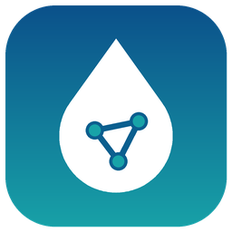

<p align="center">
  
</p>

# Mirab

Mirab is a free, cross-platform desktop application for modeling water distribution and stormwater systems. It puts several established solvers behind one interface, so you pick the engine and keep working in the same project, on the same map, with the same tools.

| Engine | Use it for | Provider |
|---|---|---|
| EPA EPANET 2.2 | Regulatory-standard pressurized network hydraulics and water quality | U.S. EPA |
| OWA EPANET 2.3 | Pressure-driven demand, FAVAD pipe leakage, PCV valves, extra units | Open Water Analytics |
| EPANET-MSX 2.0 | Multi-species reactions, on top of either EPANET engine | U.S. EPA |
| EPA SWMM 5.2 | Urban drainage, runoff, hydraulics and pollutants | U.S. EPA |
| SWMM5+ 1.0 | Finite-volume dynamic-wave routing (optional add-on) | CIMM, UT Austin |

Mirab runs on Windows, macOS and Linux. It needs no Python, no QGIS and no other software on the user's machine.

## What you can do


- **Build and edit networks** in a clean, light interface with a start page, a project tree, a searchable property editor and context menus: junctions, tanks, reservoirs, pipes, pumps and valves for EPANET; junctions, outfalls, storage, conduits, orifices, weirs, outlets, subcatchments and rain gages for SWMM.
- **Switch engines** from a drop-down. Mirab checks the project against each engine's capability manifest and tells you what will be ignored or cannot run. Data an engine does not support is greyed out in the property editor.
- **Run simulations** in an isolated solver process, so a solver crash can never close the application. Progress and cancellation work for every engine.
- **Work on real maps**: OpenStreetMap, satellite, topographic and light basemaps or your own WMS, WMTS and tile services under the network, in any of about 1,950 coordinate systems (UTM, State Plane, national grids, or a `.prj` file). Show GeoTIFF elevation models as hillshade and set node elevations from them.
- **Import GIS and CAD data** from shapefiles, DXF drawings and CSV tables, with field mapping, endpoint snapping and reprojection.
- **Explore results** with map coloring, flow arrows, an animated time slider, hover read-outs and time-series charts.
- **Report** with network tables (sortable, with filters such as `Pressure < 20`), multi-element time series, profile plots, frequency and variability plots, system flow balances, pump energy audits and the engine's status report; every report exports CSV.
- **Edit patterns, curves and time series** in tabs with live charts.
- **Evaluate resilience** with native implementations of the Todini index, water service availability, network topology (bridges and articulation points), pipe criticality and fire-flow capacity.
- **Exchange data** as GeoPackage or GeoJSON for QGIS and other GIS tools, and as WNTR JSON for the Python water community. "Open in QGIS" exports and launches QGIS in one step.
- **Edit the input file directly** in a syntax-highlighted text view. The `.inp` file stays the master copy, and Mirab preserves every comment and line you did not change.
- **Extend Mirab** with C++ plugins built against Qt 6.

## Download

Installers for Windows (`.exe` and `.zip`), macOS (`.dmg`) and Linux (`.AppImage` and `.tar.gz`) are attached to each [release](https://github.com/ehsanMa86/Mirab/releases). Example models are installed with the application and are also in [`examples/`](examples).

SWMM5+ is an optional engine for Windows, macOS and Linux, published separately by [swmm5plus-capi](https://github.com/ehsanMa86/swmm5plus-capi). Install it from *Project > Simulation engines > Install SWMM5+*, with `mirab --install-engine swmm5plus` in a deployment script, or with `mirab-cli engines install <manifest.json>` for offline use. See [docs/engines.md](docs/engines.md#installing-swmm5).

## Command line

Every capability is also available from `mirab-cli`, which ships next to the application:

```
mirab-cli engines
mirab-cli run examples/epanet/mirab-demo.inp --engine epanet-2.3-owa
mirab-cli run examples/epanet/mirab-demo.inp --engine epanet-msx-2.0-owa23 --msx examples/msx/mirab-demo.msx
mirab-cli results examples/epanet/mirab-demo.anr --table node --variable Pressure --element J5
mirab-cli resilience fireflow examples/epanet/mirab-demo.inp --flow 30 --residual 14
mirab-cli export gpkg examples/swmm/mirab-urban.inp --out urban.gpkg --crs EPSG:32614
mirab-cli model set examples/epanet/mirab-demo.inp --id J1 --column Elevation --value 21 --out j1.inp
```

Run `mirab-cli --help` for the full list. Every command has a `--json` form, described in [docs/cli.md](docs/cli.md).

### Python

The `mirab` Python package in [integrations/python](integrations/python) scripts Mirab through `mirab-cli`: open a model, read and change element values, run simulations with live results, read result files into NumPy or pandas and run many variants in parallel. The desktop application itself does not need Python. See [docs/python.md](docs/python.md).

## Building from source

You need CMake 3.21 or newer, a C++17 compiler and Qt 6.5 or newer. The engines are downloaded at pinned versions during the first configure.

```
cmake --preset release
cmake --build --preset release
ctest --preset release
cmake --build --preset release --target package
```

Use the `headless` preset to build the command-line tool and libraries without Qt. Platform notes are in [docs/building.md](docs/building.md).

## Documentation

- [User guide](docs/user-guide.md)
- [Engines and compatibility](docs/engines.md)
- [Resilience tools](docs/resilience.md)
- [Architecture](docs/architecture.md)
- [File formats and the solver protocol](docs/file-formats.md)
- [Command line and JSON output](docs/cli.md)
- [Python scripting](docs/python.md)
- [Building and packaging](docs/building.md)
- [Writing plugins](docs/plugins.md)

## License

Mirab is free software, licensed under the [GNU General Public License, version 3 or later](LICENSE).
Copyright (C) 2026 Ehsan Madadi.

The simulation engines keep their own licenses and copyright notices; see [THIRD_PARTY_NOTICES.md](THIRD_PARTY_NOTICES.md). Mirab is not affiliated with or endorsed by the U.S. EPA, Open Water Analytics or CIMM.
