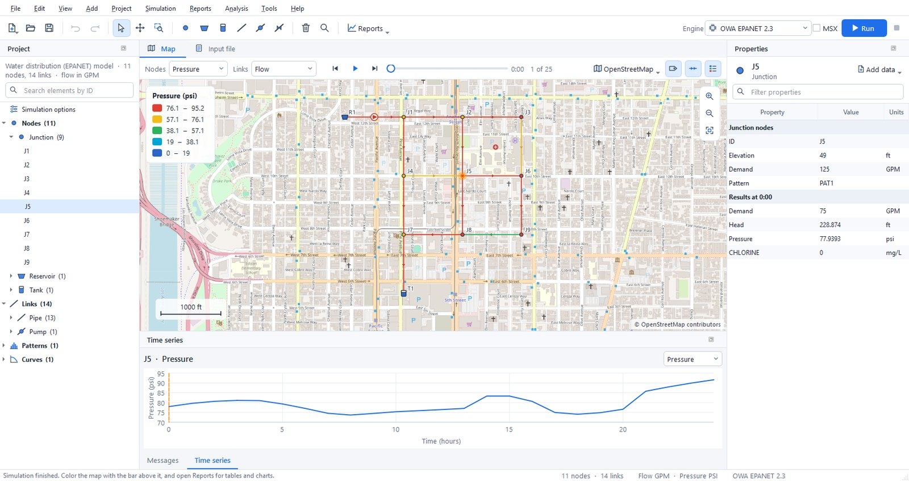
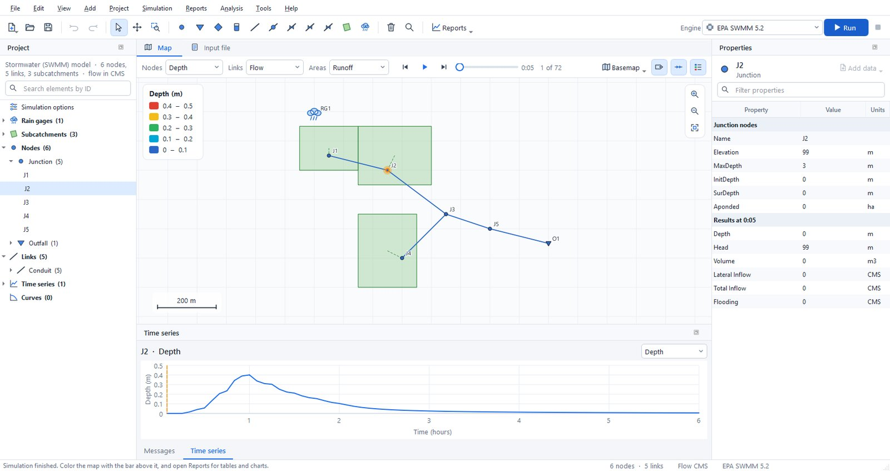
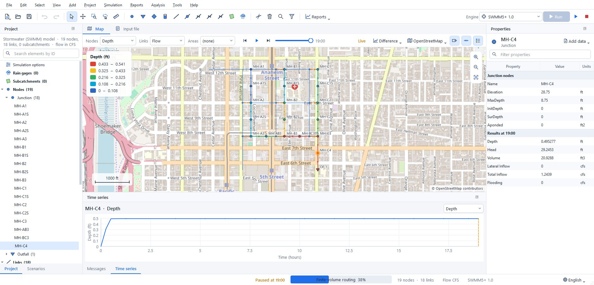
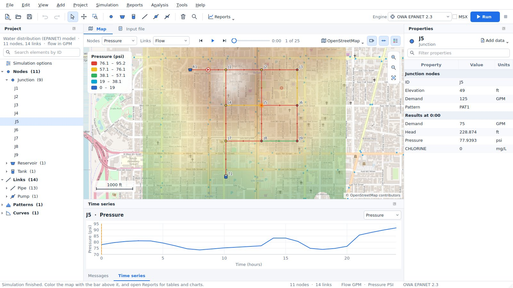
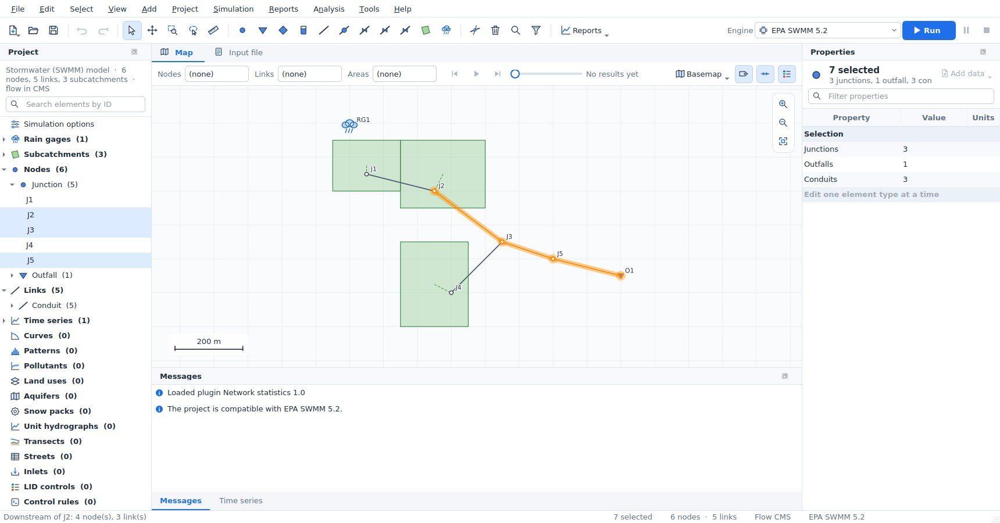
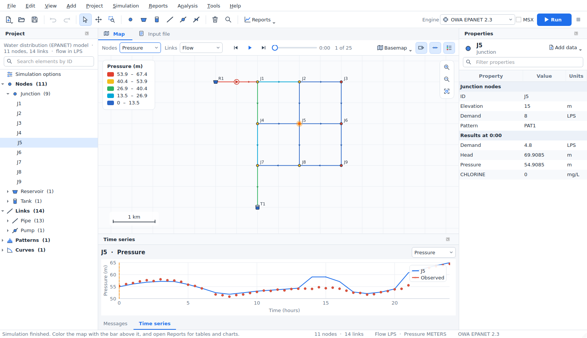
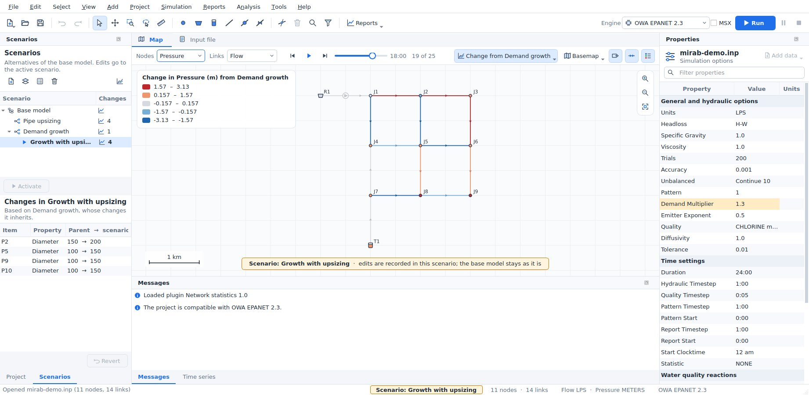
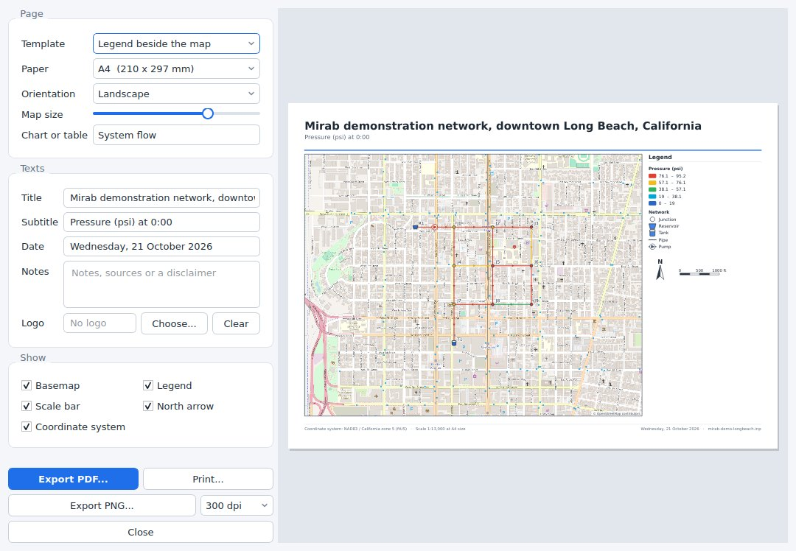
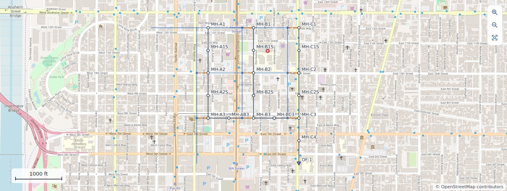

{ .mirab-hero-icon }

# Mirab

**Water distribution and stormwater modeling in one free desktop application.**
Pick EPANET, SWMM or SWMM5+ from a list and keep working in the same project, on the same map, with the same tools.
Mirab runs on Windows, macOS and Linux and needs no other software.

[Download](download.md){ .md-button .md-button--primary }
[User guide](user-guide.md){ .md-button }
[Source on GitHub](https://github.com/ehsanMa86/Mirab){ .md-button }

{ .mirab-shot }

## Engines

| Engine | Use it for | Provider |
|---|---|---|
| EPA EPANET 2.2 | Regulatory-standard pressurized network hydraulics and water quality | U.S. EPA |
| OWA EPANET 2.3 | Pressure-driven demand, FAVAD pipe leakage, PCV valves, extra units | Open Water Analytics |
| EPANET-MSX 2.0 | Multi-species reactions, on top of either EPANET engine | U.S. EPA |
| EPA SWMM 5.2 | Urban drainage, runoff, hydraulics and pollutants | U.S. EPA |
| SWMM5+ 1.0 | Finite-volume dynamic-wave routing (optional add-on) | CIMM, UT Austin |

Mirab checks each project against the engine you choose and tells you what that engine ignores or cannot run. Simulations run in a separate process, so a solver crash never closes the application, and every engine can be paused, resumed or stopped with its partial results kept. See [Engines and compatibility](engines.md).

## What you can do

-   **Build and edit models**

    ---

    

    Junctions, tanks, pipes, pumps and valves for EPANET; junctions, outfalls, storage, conduits, subcatchments and rain gages for SWMM. Forms and dedicated editors cover every part of a SWMM model, from pollutants to LID controls and control rules.

-   **Watch results as the engine runs**

    ---

    

    The map, time slider and charts fill in while the simulation runs. Color the network by any result, show flow arrows and animate the time steps.

-   **Work on real maps**

    ---

    

    OpenStreetMap, satellite and topographic basemaps or your own WMS and WMTS services, about 1,950 coordinate systems, and GeoTIFF elevation models that set node elevations.

-   **Select and trace**

    ---

    

    Rectangles, polygons and queries such as `Diameter < 200 AND Pressure < 20`; upstream and downstream traces, shortest paths and editing of many elements at once.

-   **Calibrate**

    ---

    

    Load field measurements, see NSE, KGE, PBIAS, RMSE and R² per series, and let Mirab search roughness, imperviousness or any other parameter automatically.

-   **Compare scenarios**

    ---

    

    Store pipe upsizing, demand growth or a larger storm as changes to the base model, run several at a time and compare them in a report and on a difference map.

-   **Report and deliver**

    ---

    

    Tables, time series, profiles and flow balances that export CSV; print layouts, PDF or HTML report documents and animated GIFs of the results.

-   **Water and wastewater together**

    ---

    

    Turn the water use of an EPANET model into dry-weather inflows of a SWMM model of the same area, with return factors and patterns.

## Also in Mirab

- **Resilience tools:** Todini index, water service availability, bridges and articulation points, pipe criticality and fire-flow capacity. See [Resilience tools](resilience.md).
- **Data exchange:** shapefiles, DXF and CSV import; GeoPackage, GeoJSON and WNTR JSON export; "Open in QGIS" in one step.
- **The input file stays the master copy:** Mirab writes standard EPANET and SWMM files and keeps every comment and line you did not change.
- **Scripting:** every capability is available from `mirab-cli`, with JSON output, and from the `mirab` Python package. See [Command line](cli.md) and [Python scripting](python.md).
- **Your language:** English, Persian, Arabic, Hebrew, Spanish, Brazilian Portuguese, French, Italian, German, Simplified and Traditional Chinese.

## Free software

Mirab is licensed under the [GNU General Public License, version 3 or later](https://github.com/ehsanMa86/Mirab/blob/main/LICENSE). The simulation engines keep their own licenses. Report problems and suggest features in [Issues](https://github.com/ehsanMa86/Mirab/issues/new/choose); contributions are welcome as pull requests, and everyone who has helped is named in [AUTHORS](https://github.com/ehsanMa86/Mirab/blob/main/AUTHORS). Mirab is not affiliated with or endorsed by the U.S. EPA, Open Water Analytics or CIMM.
