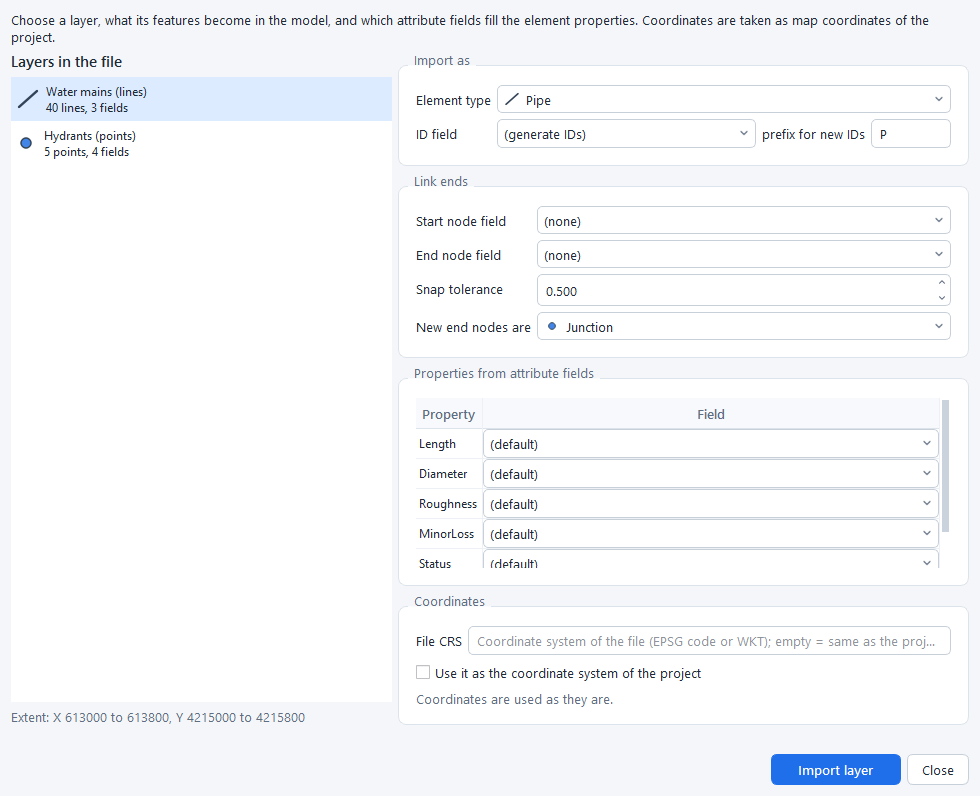
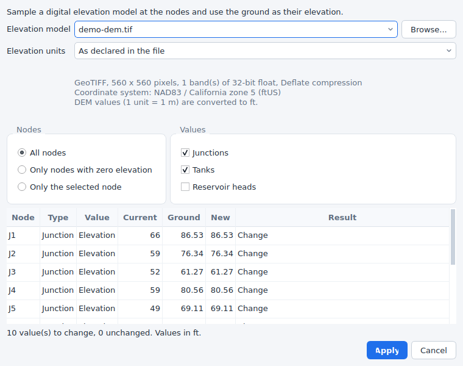
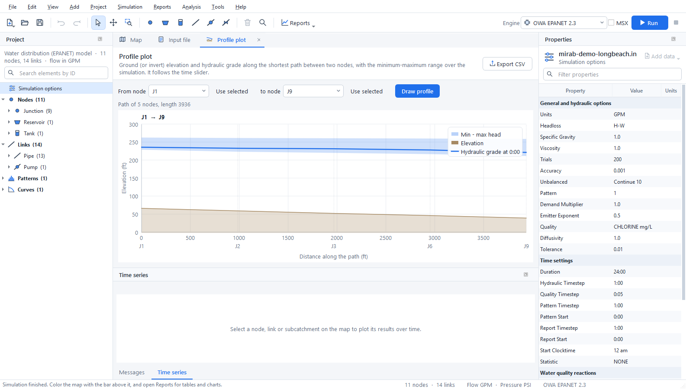
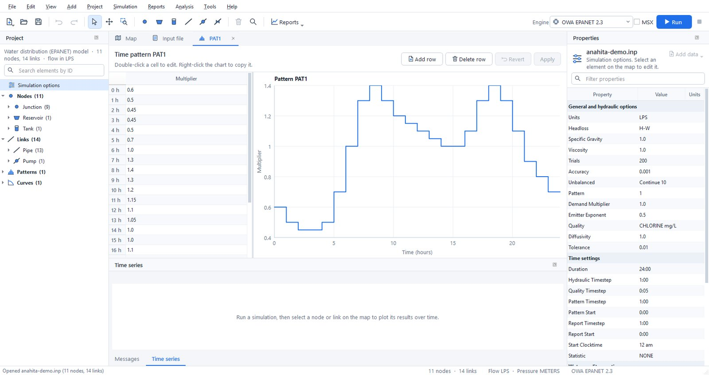
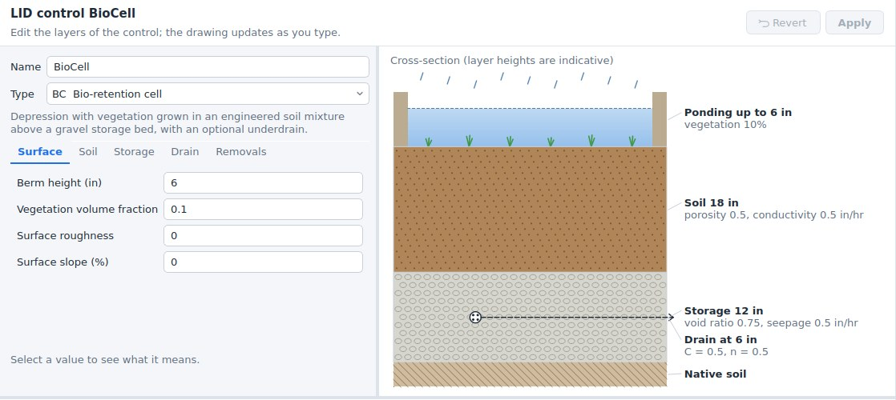
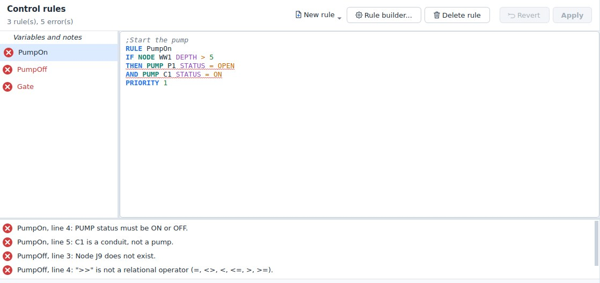
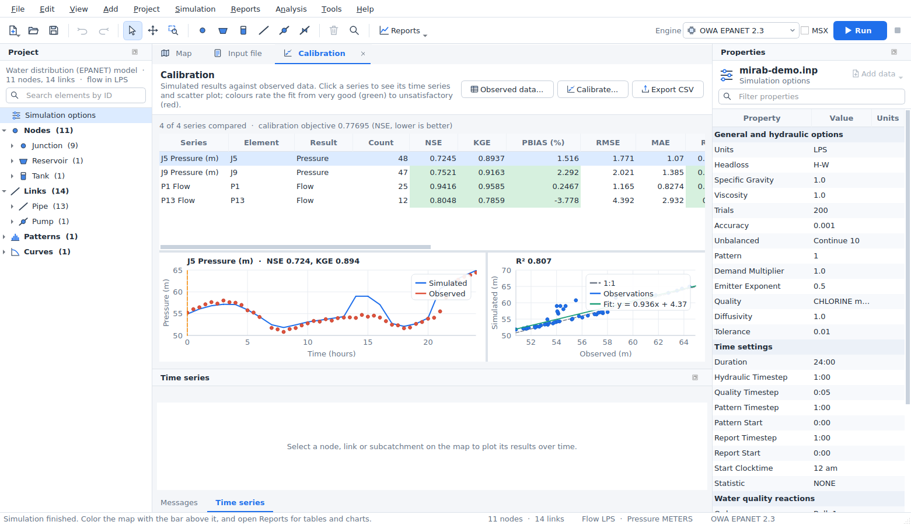
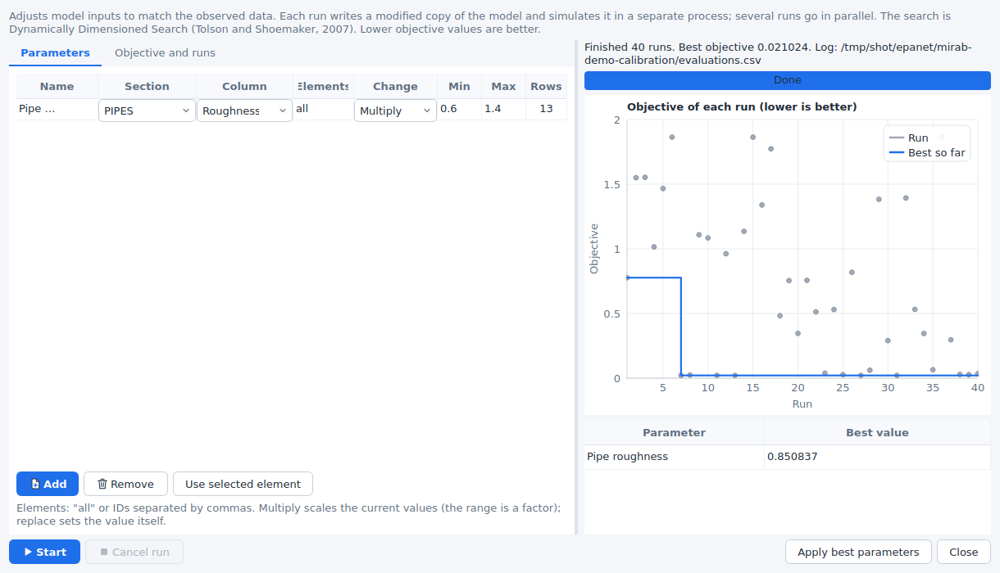

# Mirab user guide


## The window

- **Start page.** It appears when no project is open, with buttons for a new water network, a new stormwater model and opening a file. It also lists recent projects and the examples. *Help > Start page* shows it again.
- **Tool bar.** It holds file commands, undo and redo, and the map tools: select, pan and zoom to a rectangle. Next come one button per element type, delete and find, the *Reports* menu, the engine selector and the *Run* button.
- **Map tab.** A bar above the map chooses the results that color nodes, links and subcatchments. It also holds the time controls (step, play, slider), the basemap and the label, flow-arrow and legend switches. Zoom buttons float at the top right of the map; a scale bar and the legend sit on the map itself.
- **Input file tab.** The `.inp` text exactly as the engines read it. Edit it and press *Apply changes*; the change can be undone as one step.
- **Report, pattern and curve tabs.** They open next to the map and close with the cross on the tab.
- **Project panel** (left). It shows a summary of the model and a search box. Below them is a tree with the simulation options, every element by type, the patterns, curves and time series and, for SWMM models, the named objects (pollutants, land uses, aquifers, ...). Double-click an element to zoom to it, a pattern, curve or object to edit it, or *Simulation options* to open the options dialog. Right-click for more.
- **Properties panel** (right). It shows the selected element, or the simulation options when nothing is selected. Click a value to edit it, and type in the filter box to find a property quickly.
- **Messages and Time series** (bottom). The Messages tab shows compatibility notes and the run log. The Time series tab plots the selected element over time.

Panels can be resized, moved, closed and floated. *View > Panels* shows a closed panel again and *View > Reset layout* restores the default arrangement. Mirab always uses a light theme.

## Creating a model

1. Choose *New water network* or *New stormwater model* on the start page (or in *File*), then choose flow units. SI units give metres, millimetres and metres of pressure head; US units give feet, inches and psi.
2. Pick an element on the tool bar and click on the map:
   - node tools place one element per click,
   - link tools need a start node, optional bend points, and an end node,
   - the subcatchment tool takes the outline corners; double-click or press Enter to finish. The nearest node becomes its outlet.

   You can also right-click an empty spot of the map and choose *Add here*.
3. Press `Esc` or right-click to return to the selection tool. Drag nodes to move them. `Delete` removes the selection and any links attached to a removed node.
4. Edit values in *Properties*. Renaming the ID updates every reference to it, including controls and rules.
5. *Add data* attaches extra rows to the selected element, such as demand categories, emitters, FAVAD leakage, water quality sources, losses or cross sections, and for SWMM external and dry weather inflows, RDII, treatment, groundwater, land use coverage, initial buildup and street inlets. Right-click a row of attached data to remove it.

Mirab writes standard EPANET and SWMM input files, so models stay usable in any other tool.

## Importing GIS and CAD data

*File > Import* reads ESRI shapefiles (`.shp` with `.dbf` and `.prj`), DXF drawings and CSV tables. You can also drop these files on the window.



1. Choose a layer. A shapefile has one layer. A DXF drawing has one layer per drawing layer and geometry type.
2. Choose what its features become:
   - **Points** become nodes, such as junctions, tanks or outfalls.
   - **Lines** become links, such as pipes or conduits.
   - **Polygons** become subcatchments in SWMM models.
3. Choose the ID field, or let Mirab generate IDs with a prefix.
4. For links, line ends within the *snap tolerance* connect to existing nodes, and new nodes are created for the others. Alternatively, choose the fields that hold the start and end node IDs; a CSV table of pipes needs no coordinates this way.
5. Map attribute fields to properties such as elevation, diameter, roughness or length. Mirab suggests fields with common names, and computes lengths and subcatchment areas from the geometry when no field is chosen.
6. When the file has a `.prj`, its coordinate system is shown:
   - If the project already has a coordinate system, the points are reprojected to it.
   - If not, *Use it as the coordinate system of the project* sets it, which also enables basemaps.

Import several layers in a row, for example junctions, then pipes, then tanks. Every import is one undoable step, and notes about skipped or invalid features appear in *Messages*.

## Basemaps and coordinate systems

The *Basemap* button on the map bar shows a web map under the network. The choices are OpenStreetMap, Esri streets, satellite imagery, topographic and light-gray maps, and OpenTopoMap. Tiles are cached on disk, so places you have visited load quickly and work offline. The attribution of the map provider is shown at the bottom right.

Basemaps need to know where the coordinates are on Earth. Use *View > Coordinate system* (or the basemap menu) to choose the coordinate reference system of the node coordinates:

- **Searching:** search about 1,950 built-in systems by name or EPSG code. They include WGS 84 and Web Mercator, every UTM zone, all NAD83 State Plane and county systems in metres and feet, ETRS89, GDA, SIRGAS and others.
- **Other definitions:** type an EPSG code, PROJ string or WKT, or load the `.prj` file of a shapefile.
- **Checking:** the dialog shows where the first node would be in latitude and longitude, so a wrong choice is easy to spot.

Coordinates that are plain longitude and latitude are recognised automatically. Datum shifts are not applied, so data on older datums such as NAD27 can appear tens of metres away from the basemap. The coordinate system is also written into GeoPackage and GeoJSON exports.

The example `examples/epanet/mirab-demo-longbeach.inp` is placed in downtown Long Beach, California, in NAD83 / California zone 5 State Plane coordinates (US survey feet, EPSG:2229). It uses US customary units and opens with an OpenStreetMap basemap.

## Rasters and map services


### Raster layers

*View > Raster layers* (also in the basemap menu) adds elevation models and georeferenced images under the network. Mirab reads them itself, with no GDAL or other software:

- **GeoTIFF** (`.tif`, `.tiff`), including BigTIFF, in strips or tiles, uncompressed or compressed with Deflate, LZW or PackBits (with or without a predictor), with 8 to 64-bit integer or floating-point values. Files saved with JPEG, LZMA, ZSTD or WebP compression are not read; save them again with Deflate or LZW.
- **ESRI ASCII grids** (`.asc`).
- The coordinate system comes from the GeoTIFF keys (EPSG codes and the common user-defined projections) or from a `.prj` file next to the raster. A world file (`.tfw`, `.wld`) places a TIFF that carries no georeferencing.
- The NoData value of the file (`GDAL_NODATA`) leaves holes transparent.

Large files are not loaded whole: Mirab reads only the parts it draws and keeps a small cache. Files with internal overviews draw faster when zoomed out.

Each layer has a style and an opacity:

| Style | Use |
|---|---|
| Hillshade | Shading of the relief over the basemap; flat ground stays clear. Raise *Hillshade exaggeration* for flat towns. |
| Colour ramp | Low ground green, high ground brown. |
| Colour ramp with hillshade | Both together. |
| Image | 8-bit grey, RGB, RGBA or palette images (aerial photos, scanned plans). |

Layers are reprojected to the project's coordinate system as they are drawn, and are drawn in list order (later layers cover earlier ones). *Elevation units* tells Mirab the units of the values when the file does not declare them: metres are assumed, or feet when the horizontal units of the raster are feet.

With an elevation layer, the status bar shows the ground elevation under the cursor in project units, and the profile plot adds the ground line along the path.

A GeoTIFF chosen with *View > Backdrop image* becomes a raster layer. Other images keep working as before with a world file.

### Elevations from a DEM

*Tools > Elevations from DEM* sets node elevations from a digital elevation model.



1. Choose the DEM: an elevation layer of the project, or any file with *Browse*. A file from *Browse* can be added to the map at the same time.
2. Check *Elevation units*. Values are converted to the project's units (metres or feet).
3. Choose the nodes: all, only those with a zero value, or only the selected node.
4. Choose the values:
   - **EPANET:** junction and tank elevations, and optionally the total head of reservoirs.
   - **SWMM:** the ground is the rim of junctions and storage units. Either the invert is set to the ground minus the maximum depth, or the maximum depth is set to the ground minus the invert. Outfalls and dividers are left unchanged.
5. The table previews the current value, the ground and the new value of every node. Nodes outside the DEM or on NoData are listed and left unchanged.
6. *Apply* changes the input file as one step that *Edit > Undo* reverses.

The node coordinates are reprojected to the coordinate system of the DEM when both are known. Elevations are interpolated between the four nearest cells.

The same is available from the command line:

```
mirab-cli elevations model.inp --dem terrain.tif                  # preview
mirab-cli elevations model.inp --dem terrain.tif --out model.inp  # write
mirab-cli elevations model.inp --dem terrain.tif --mode missing --reservoirs --dem-units ft --out model.inp
mirab-cli elevations sewer.inp --dem terrain.asc --swmm depth --out sewer.inp
```

`--mode` is `all`, `missing` or `selected` (with `--nodes ID,ID`), `--swmm` is `invert` or `depth`, `--dem-units` is `auto`, `m`, `ft` or `usft`, and `--crs` overrides the project's coordinate system. `--json` prints the table as JSON.

### Map services

Besides the built-in basemaps, *Add map service* in the basemap menu uses any of:

- **Tile address templates (XYZ)** such as `https://tiles.example.org/{z}/{x}/{y}.png`, with `{s}` for subdomains and `{-y}` for TMS row order. The tiles must be in Web Mercator.
- **OGC WMS** (1.1.1 and 1.3.0). Enter the service address and press *Load layers*: Mirab reads the capabilities and lists the layers, styles, formats and coordinate systems. Maps are requested in Web Mercator when the server offers it, otherwise in the project's coordinate system.
- **OGC WMTS** (1.0.0), with tile matrix sets in Web Mercator, the project's coordinate system or longitude/latitude.

Tiles go through the same disk cache as the built-in basemaps. Added services are kept in the application settings; a project that uses one also stores its definition, so it shows the same basemap on another computer. *View > Basemap > Remove* deletes the current service from the list. Problems such as an unreachable server are shown in red at the bottom of the map.

## Choosing an engine

The engine box on the tool bar lists the engines for the model type. Engines that are not installed are disabled; *Project > Simulation engines* explains why.

SWMM5+ is an optional engine. Open *Project > Simulation engines* and click *Install SWMM5+*: Mirab downloads it, checks every file and adds it to the engine box. Without internet access, download the files for your computer from the swmm5plus-capi release page and use *Install from file...*. See [engines.md](engines.md#installing-swmm5) for details.

- **MSX:** for EPANET models, tick *MSX* to run EPANET-MSX on top of the selected EPANET engine, and choose the `.msx` file.
- **Messages:** the panel always shows how the project fits the selected engine.
  - **Information:** the project is fully supported.
  - **Warning:** this engine ignores a feature. Mirab removes it from the copy sent to the engine and tells you.
  - **Error:** the engine cannot run the project, and the Run button is disabled.
- **Greyed-out data:** data the selected engine does not model is greyed out in *Properties*. For example, the `[LEAKAGE]` rows of a pipe are greyed out under EPA EPANET 2.2, and PCV is not offered as a valve type.

The choice of engine, the MSX file, the coordinate system, the basemap (with the definition of a custom map service), the raster layers, the backdrop, and the observed data and calibration set-up are saved next to the model in `<model>.inp.mirab.json`.

## Running and viewing results

Press `F5` or *Run*. The engine runs in a separate process, so you can keep working.

- **Live results:** the map, the legend, the time controls and the Time series panel fill in while the simulation runs. The time slider covers the periods computed so far and follows the latest one until you move it; the map bar shows how far the run has got. Several times a second the newest period arrives; the complete results replace these when the run ends. Values an engine cannot report during the run (for SWMM 5.2: link volumes, groundwater, snow and pollutants) show as *n/a* until then.
- **Pause:** `F6` or *Pause* holds the engine between two time steps; the status bar shows *Paused at* the simulation time reached. Press it again to resume.
- **Stop:** *Stop* ends the run. The periods computed so far stay on the map, marked *Partial results (cancelled at ...)*. Partial results are not saved; the `.anr` file of the last complete run is kept.

When the run finishes:

- **Map colors:** the map colors nodes, links and subcatchments by the results chosen on the map bar, with a legend and flow-direction arrows.
- **Time controls:** the time controls step through the reporting periods or animate them.
- **Hover:** hovering over an element shows its results at the current time.
- **Properties:** *Properties* lists the selected element's results under its input data.
- **Time series:** the Time series panel plots the selected element over time. Right-click the chart to copy it, save it as an image or copy its data.
- **Saved results:** results are saved as `<model>.anr` and reload when the model is opened again.

*Simulation > Load results* also opens binary output files (`.out`) written by EPANET or SWMM elsewhere.

## Reports

The *Reports* menu and tool bar button open report tabs. Each report follows new results, and most follow the time slider. Every report can export CSV.

| Report | What it shows |
|---|---|
| Network tables | Properties and results of every node, link or subcatchment at the current time. Sort by any column and filter with expressions such as `Pressure < 20` or `Diameter >= 300`. Selecting a row selects the element on the map. |
| Time series | One result for several elements on one chart. |
| Profile plot | Ground or invert elevation and the hydraulic grade along the shortest path between two nodes, with the minimum-maximum range over the simulation. With an elevation layer, the ground from the DEM is drawn along the path; SWMM profiles also show node rims and conduit crowns. |
| Frequency plot | The distribution of a result over all elements at one time, with minimum, median, mean and maximum. |
| Variability plot | The minimum, 10th-90th percentile band, median, mean and maximum of a result over all elements (or one type) at every time. |
| System flow | EPANET: water supplied by reservoirs, consumed by demands and stored in tanks. SWMM: runoff, outfall discharge and flooding. |
| Energy report | EPANET pumps: utilization, average efficiency, energy per volume pumped, average and peak power, energy and cost per day. |
| Calibration | Every observed series against the simulation: a goodness-of-fit table and, for the selected series, a time-series chart and a 1:1 scatter plot. See [Calibration](#calibration). |
| Status report | The engine's own report file. |

*Reports > Fire flow analysis* opens the fire-flow capacity analysis of the resilience tools.



## Patterns, curves and time series

Double-click a pattern, curve or time series in the *Project* panel to edit it in a tab. The tab shows a table of values next to a chart that updates while you type. *Apply* writes the changes as one undoable step, and *Revert* discards them.



## Stormwater data (SWMM)

Everything in a SWMM 5.2 input file can be edited without the text view.

- **Named objects.** The *Project* panel lists pollutants, land uses, aquifers, snow packs, unit hydrographs, transects, streets, inlets, LID controls and control rules, with their counts. Right-click a group to add an object, or an object to rename or delete it. Renaming updates every reference (a renamed pollutant changes its inflows, dry weather flows, buildup, washoff, initial loadings and treatment expressions). Deleting removes the data that cannot exist without the object, such as the inflows of a deleted pollutant or the buildup of a deleted land use, and clears optional references such as a co-pollutant. Undo restores everything.
- **Object editor.** Double-click an object to edit it in a tab. Each value has its own field with its units, and a tooltip with the SWMM name and meaning; choices and references to other objects, time series, patterns and curves are drop-down lists. A land use shows its buildup and washoff functions for every pollutant in tables. Snow packs show one box per surface (plowable, impervious, pervious, removal) and inlets one box per part, so a combination inlet has a grate and a curb opening. *Apply* writes the changes as one undoable step. Unit hydrographs, transects, LID controls and control rules have their own editors, described below.
- **Element data.** In *Properties*, the data attached to a node, link or subcatchment appears under its own heading: external inflows ([INFLOWS]), dry weather inflows ([DWF]), RDII, treatment, groundwater and its flow expressions, land use coverage, initial buildup and inlet usage. Each value has a name and units; references offer the existing objects.
- **Checks.** *Project > Check compatibility* (also run when a project opens or the engine changes) reports references to objects that do not exist (an inflow of an unknown pollutant, a coverage of an unknown land use, a groundwater outlet that is not a node) in *Messages*.
- **Engine support.** Data the selected engine does not simulate is greyed out with the reason, for example pollutants, LID controls, streets and inlets with SWMM5+. The data stays in the input file.

The example `examples/swmm/mirab-quality.inp` uses pollutants, land uses, buildup and washoff, external and dry weather inflows, treatment, groundwater and RDII.

## Simulation options

*Project > Simulation options* (or a double-click on *Simulation options* in the *Project* panel) opens a dialog with one page per topic:

- **SWMM:** general settings (flow units, infiltration model, routing method, link offsets, ponding, steady periods, and which process models run), analysis and reporting dates, time steps, dynamic wave settings, interface files ([FILES]: hotstart, rainfall, runoff, RDII, inflows and outflows), reporting ([REPORT]), evaporation (constant, monthly, time series, temperature or climate file, with a soil recovery pattern), temperature, wind speed and snowmelt ([TEMPERATURE]), and monthly adjustments ([ADJUSTMENTS]).
- **EPANET:** hydraulics and demands, water quality and reactions, times, energy and reporting.

Dates and times use calendar and clock fields; choices use drop-down lists. Only the values you change are written, as one undoable step, and options the dialog does not show are kept. The *Properties* panel still lists the options as plain rows when nothing is selected.

## LID controls, transects, unit hydrographs and control rules

These SWMM sections have their own editors. They open in a tab like the pattern editor, with *Revert* and *Apply* in the header and a list of problems at the bottom that updates while you type. *Apply* is disabled while there are errors, except for control rules, which can be applied unfinished. Renaming an object also updates the rows that use it ([LID_USAGE], irregular [XSECTIONS], [RDII]). Lines and comments of other objects in the section are kept as they are.

**LID controls** ([LID_CONTROLS]). Choose the type (bio-retention cell, rain garden, green roof, infiltration trench, permeable pavement, rain barrel, rooftop disconnection or vegetative swale); only the layers that type uses are shown: surface, pavement, soil, storage, drain, drainage mat and pollutant removals. Each value shows its unit, and a description appears below the form when you click it. The drawing on the right is a cross-section of the layers (heights are indicative, not to scale) with the drain at its offset height, and it changes as you type. The checks follow SWMM: for example the field capacity must be below the porosity, the wilting point below the field capacity, and a drain's open level above its closed level.



**LID usage** ([LID_USAGE]). Right-click a subcatchment on the map or in the *Project* panel and choose *LID usage...*. The dialog lists the LID units of the subcatchment: control, number of units, area and width of each unit, initial saturation, the percentages of the impervious and pervious areas treated, whether the outflow goes to the pervious area, the drain outlet and an optional report file. Below the table, the total LID area is compared with the subcatchment area; above 100 % the line turns red, because SWMM stops with an error.

**Transects** ([TRANSECTS]). Enter the stations and elevations from left to right looking downstream (Ctrl+V pastes two columns from a spreadsheet), the Manning's n of the left overbank, channel and right overbank, the bank stations and the modifiers (stations factor, elevation offset, meander factor). The chart shows the section with the modifiers applied, the banks as dashed lines and a water surface whose depth you set with the slider; the line below the chart gives the flow area, top width, wetted perimeter and hydraulic radius at that depth. Several transects can share the section; when a transect takes its n values from the one above it, Mirab keeps that working when you change the one above.

**Unit hydrographs** ([HYDROGRAPHS]). Choose the rain gage, then a month on the left (*All months* or January to December) and enter R, T and K of the short, medium and long-term responses, with the optional initial abstraction depth, recovery rate and initial value. Months with their own values are shown in blue; the others use the *All months* values. The chart shows the three triangular hydrographs of the month and their total.

**Control rules** (SWMM [CONTROLS], EPANET [RULES] and simple [CONTROLS]). Open them from *Project > Control rules*. The list on the left has one entry per rule, plus *Variables and notes* for the lines before the first rule (SWMM `VARIABLE` and `EXPRESSION` definitions go there). The selected rule is shown with syntax colors; lines with errors are underlined, and each problem names the rule and line. Rules are checked as SWMM 5.2 checks them: clause order (IF, AND, OR, THEN, ELSE, PRIORITY), object types and their attributes, relational operators, values (status words, times, dates, months), settings by number, `CURVE`, `TIMESERIES` or `PID`, named variables and expressions, and whether every node, link, gage, curve and time series exists and has the right type. *New rule* inserts a template (pump on and off by wet-well depth, orifice by time of day, weir by flow, control curve, PID controller, named variable); *Rule builder* composes a rule from lists of the model's objects.



`mirab-cli info model.inp` prints the same checks, with the line number in the file for rule problems.

## Resilience tools

*Analysis* offers five analyses for EPANET models: the Todini index, water service availability, network topology, pipe criticality and fire-flow capacity. See [resilience.md](resilience.md) for the methods. Selecting a row in the result table highlights the element on the map.

## Calibration

Mirab compares simulations with measurements and can adjust model inputs until they match. It works the same way for EPANET and SWMM models.

### Observed data

*Project > Observed data* lists the measurement files of the project. *Add files* accepts:

- **Text tables** (`.csv`, `.tsv`, `.txt`): one time column and one or more value columns, separated by commas, semicolons, tabs or blanks. A first row of names is optional; rows starting with `#` are comments. Times can be dates and times (`2024-05-01 13:30`, `2024-05-01T13:30:00`, `05/01/2024 1:30 PM`, `01-May-2024 13:30`, or a date column followed by a time column) or elapsed time since the start of the simulation (`1.5` hours, or minutes, seconds or days, or `36:30`). Choose *Day first* for `DD/MM/YYYY` dates. Empty cells, `NA`, `NaN` and `-` are missing values, and you can add your own marker such as `-9999`. Decimal commas are read when the separator is a semicolon or a tab.
- **EPANET calibration files** (`.dat`): rows of location ID, time (hours or `h:mm`) and value. A row without an ID continues the location above. Text after `;` is a comment.

  ```
  ; Flow in pipes P1 and P13 (L/s)
  P1    0:00   21.2
        1:00   19.4
  P13   1:00   26.9
  ```

- **SWMM calibration files** (`.dat`): a location ID on a line of its own, followed by rows of date, time and value (`01/01/2026 00:15 0.2`) or elapsed days, time and value (`0 00:15 0.2`).

Each column or location becomes a series linked to an element type (node, link or subcatchment), an element ID and a result, such as junction `J5` *Pressure*, pipe `P12` *Flow*, SWMM node *Depth* or outfall *Total Inflow*. Mirab proposes the links from column names such as `J5 Pressure (psi)` or `P1_flow`. Give the unit of the measurements when it differs from the model's (`psi`, `kPa`, `bar`, `m`, `ft`, `in`, `mm`; `GPM`, `LPS`, `L/s`, `CFS`, `CMS`, `m3/s`, `MGD`, `MLD`, `CMH`, `m3/h`; `m/s`, `ft/s`); pressures and heads convert through metres of water. The weight sets how much a series counts in the calibration objective. The preview shows the selected series over the simulated result.

Times have no time zone. Dated measurements are placed on the simulation clock with the start date: SWMM models use `START_DATE` and `START_TIME`; EPANET models start at their start clock time on the day of the first measurement, unless you enter *Simulation starts at*. Measurements outside the simulated period are left out.

The list is saved with the project in `<model>.inp.mirab.json`, with file paths relative to the model. Once linked, measurements appear as markers in the Time series panel and the Time series report.

### Goodness of fit

*Reports > Calibration* aligns each series with the simulation: the simulated result is interpolated linearly at every measurement time. The table, which sorts by any column and exports CSV, gives:

| Metric | Definition (observed *o*, simulated *s*, means *ō*, *s̄*) | Best |
|---|---|---|
| NSE | Nash-Sutcliffe efficiency, 1 - Σ(s - o)² / Σ(o - ō)² | 1 |
| KGE | Kling-Gupta efficiency (2012), 1 - √((r - 1)² + (β - 1)² + (γ - 1)²) with correlation r, bias ratio β = s̄/ō and ratio of the coefficients of variation γ | 1 |
| PBIAS | Percent bias, 100 Σ(s - o) / Σo; positive values mean the model over-predicts | 0 |
| RMSE, MAE | Root mean square error and mean absolute error, in result units | 0 |
| R² | Square of the Pearson correlation | 1 |
| Peak error | Simulated peak minus observed peak, in percent of the observed peak | 0 |
| Peak timing | Time of the simulated peak minus time of the observed peak, hours | 0 |
| Volume error | Difference of the volumes under the two series (trapezoidal rule), in percent; flows only | 0 |

Cells are coloured by quality bands: NSE above 0.75 very good, 0.65 good, 0.50 satisfactory; PBIAS within ±10 % very good, ±15 % good, ±25 % satisfactory (Moriasi et al., 2007); R² above 0.85, 0.75, 0.60 (Moriasi et al., 2015); KGE above 0.75, 0.60, 0.50; volume error within 5, 10, 20 %; peak error within 10, 20, 30 %. The rating column combines NSE and PBIAS. Selecting a row plots the series over time, with the measurements as markers, and as a scatter plot with the 1:1 line and the least-squares fit.



### Automated calibration

*Project > Calibrate* adjusts model inputs to minimise an objective:

- **Parameters.** Each parameter is a numeric column of a section (for example `[PIPES]` *Roughness*, `[CONDUITS]` *Roughness*, `[SUBCATCHMENTS]` *PctImperv* or `[JUNCTIONS]` *Demand*) for all its rows or for listed element IDs (*Use selected element* adds the element selected on the map). *Multiply* scales the current values by a factor between the minimum and maximum; *Replace* sets the value itself. The *Rows* column shows how many rows a parameter changes.
- **Objective.** A weighted sum over the series (each with its weight) of chosen metrics: NSE, KGE and R² count as 1 minus the value; PBIAS, peak error and volume error as their size in percent divided by 100; RMSE and MAE in result units; peak timing in hours. Metrics that do not apply to a series (volume error of a pressure) are left out.
- **Runs.** The number of model runs, how many run in parallel and the random seed.

The search is Dynamically Dimensioned Search (Tolson and Shoemaker, 2007): it starts from the current model, then perturbs a random subset of the parameters of the best set found so far, a subset that shrinks as the runs are used up. It suits budgets from a few dozen to a few thousand runs. *Sensitivity screening* instead runs a Latin hypercube sample of the parameter ranges and reports the rank correlation of each parameter with the objective.

Every run writes a modified copy of the model and simulates it in its own `mirab-cli` process, so an engine failure ends that run only. The chart shows the objective of each run and the best so far; *Cancel run* stops the runs in progress. When it finishes, *Apply best parameters* writes the best values into the model as one edit, which *Undo* reverts. Each calibration also leaves a folder `<model>-calibration` next to the model with `evaluations.csv` (every run: objective, parameter values and the first metric of each series), `best.json` (the best values and their metrics) and `<model>-best.inp`.



### Try it

The examples include measurements of models that differ from the examples in known ways:

- `epanet/mirab-demo.inp`: pressures at J5 and J9 every 30 minutes (`mirab-demo-pressure.csv`) and flows in P1 and P13 (`mirab-demo-flow.dat`), measured with pipe roughness coefficients 15 % below the model's. Calibrating *Pipe roughness* should find a multiplier close to 0.85.
- `swmm/mirab-urban.inp`: outfall flow (`mirab-urban-outfall.dat`) and the depth at J3 (`mirab-urban-depth.csv`) of a model with conduit roughness 20 % higher and imperviousness 10 % lower. Calibration finds an imperviousness multiplier close to 0.9; the outfall flow is much less sensitive to the roughness, so its multiplier is found less precisely, as a sensitivity screening shows.

Both measurement sets include noise, so the fit is good but not perfect.

### From the command line

```
mirab-cli calibrate metrics model.inp [--observed calib.json|data.csv|data.dat] [--results model.anr] [--json|--csv]
mirab-cli calibrate model.inp [--config calib.json] [--engine ID] [--jobs N] [--budget N] [--seed N]
                  [--method dds|lhs] [--out-dir DIR] [--start "2024-05-01 00:00"] [--keep-runs]
```

`calibrate metrics` compares existing results (`model.anr`, or `--results`) with the observed data of the project. `calibrate` runs the optimisation with the set-up saved with the project, or with a `--config` file in the same form, and prints each run. The set-up is the `calibration` member of the project file (a `--config` file may also hold it alone):

```json
{
  "observed": [
    {"file": "pressure.csv", "format": "csv", "noData": "-9999",
     "links": [{"column": "J5 Pressure (m)", "table": "node", "element": "J5", "variable": "Pressure", "unit": "m"}]},
    {"file": "flow.dat", "format": "epanet", "table": "link", "variable": "Flow", "unit": "LPS"}
  ],
  "simulationStart": "2024-05-01 00:00",
  "parameters": [
    {"name": "Pipe roughness", "section": "PIPES", "column": "Roughness", "elements": "all",
     "mode": "multiply", "min": 0.6, "max": 1.4}
  ],
  "objective": [{"metric": "NSE", "weight": 1}],
  "budget": 100, "jobs": 4, "seed": 1
}
```

`format` is `csv`, `epanet`, `swmm` or `auto`. Text tables also take `timeColumn`, `timeFormat` (`datetime` or `elapsed`), `timeUnit` (`hours`, `minutes`, `seconds`, `days`) and `dateOrder` (`MDY` or `DMY`). Without `links`, every column is linked by its name. With `--machine`, `calibrate` reports each run as an `evaluation` event (index, objective, best so far, parameter values) and stops on a `cancel` line.

## GIS and QGIS

- *File > Export > GeoPackage* writes one layer per element type (junctions, pipes, conduits, subcatchments, ...) with every input value and, when results are loaded, the values of the current period.
- *File > Open in QGIS* writes `<model>.gpkg` and starts QGIS with it. QGIS is never loaded inside Mirab, so a QGIS installation problem cannot affect it. Set the QGIS program in *Tools > Settings* if it is not found.
- *View > Backdrop image* shows a PNG, JPEG or TIFF behind the network. With a world file (`.pgw`, `.jgw`, `.tfw` or `.wld`) the image is georeferenced; without one it is stretched over the network. A georeferenced GeoTIFF becomes a raster layer (see [Rasters and map services](#rasters-and-map-services)).

## WNTR

*File > Export > WNTR network* writes the JSON layout read by `wntr.network.read_json`, in SI units. *File > Import > WNTR network* reads a file written by `wntr.network.write_json` and saves it as an EPANET input file in LPS. Controls, rules and quality sources are reported as not transferred.

## Keyboard shortcuts

| Key | Action |
|---|---|
| `F5` | Run simulation |
| `F6` | Pause or resume the simulation |
| `F` | Zoom to fit |
| `+`, `-`, arrow keys | Zoom and pan the map |
| `S` | Selection tool |
| `H` | Pan tool |
| `Z` | Zoom to a rectangle |
| `Esc` | Cancel the current tool or clear the selection |
| `Delete` | Delete the selection |
| `Ctrl+Z`, `Ctrl+Y` | Undo, redo |
| `Ctrl+F` | Find an element by ID and zoom to it |

## Command-line options

`mirab [file.inp]` opens a project. Other options:

| Option | Effect |
|---|---|
| `--import FILE` | Opens the import dialog for a shapefile, DXF drawing or CSV table. |
| `--show-data SECTION:ID` | Opens the editor of a pattern, curve, time series, named object, LID control, transect or unit hydrograph group, for example `PATTERNS:PAT1`, `POLLUTANTS:TSS` or `LID_CONTROLS:Cell1`; `CONTROLS:` or `RULES:` opens the control rules and `LID_USAGE:S1` the LID usage of subcatchment S1. |
| `--options-dialog PAGE` | Opens the simulation options dialog at a page: `general`, `dates`, `steps`, `dynwave`, `files`, `report`, `evaporation`, `climate`, `adjustments` (SWMM) or `hydraulics`, `quality`, `times`, `energy`, `report` (EPANET). |
| `--select ID` | Selects an element. |
| `--open-tool NAME` | Opens a tool dialog: `elevations`, `raster-layers`, `map-service`, `observed-data`, `calibration`, or `calibration-run` (starts the calibration). |
| `--install-engine swmm5plus` | Installs SWMM5+ without opening a window (also a manifest URL or file). |
| `--screenshot FILE.png` | Saves a picture of the window and quits; with `--run` (run first), `--report KIND` (open a report: tables, timeseries, profile, frequency, variability, systemflow, energy, calibration, status) and `--delay MS`. With `--run`, `--run-for MS` takes the picture while the simulation runs, and `--pause-after MS` or `--stop-after MS` pause or stop it first. |

Every analysis is also available without a window through `mirab-cli`; run `mirab-cli` without arguments for its commands.
