# Mirab user guide


## The window

- **Start page.** It appears when no project is open, with buttons for a new water network, a new stormwater model and opening a file. It also lists recent projects and the examples. *Help > Start page* shows it again.
- **Tool bar.** It holds file commands, undo and redo, and the map tools: select, pan, zoom to a rectangle, select with a polygon and measure. Next come one button per element type, split, delete, find and select by query, the *Reports* menu, the engine selector and the *Run* button.
- **Map tab.** A bar above the map chooses the results that color nodes, links and subcatchments. It also holds the time controls (step, play, slider), the basemap and the label, flow-arrow and legend switches. Zoom buttons float at the top right of the map; a scale bar and the legend sit on the map itself.
- **Input file tab.** The `.inp` text exactly as the engines read it. Edit it and press *Apply changes*; the change can be undone as one step.
- **Report, pattern and curve tabs.** They open next to the map and close with the cross on the tab.
- **Project panel** (left). It shows a summary of the model and a search box. Below them is a tree with the simulation options, every element by type, the patterns, curves and time series and, for SWMM models, the named objects (pollutants, land uses, aquifers, ...). Double-click an element to zoom to it, a pattern, curve or object to edit it, or *Simulation options* to open the options dialog. Ctrl+click and Shift+click select several elements. Right-click for more.
- **Scenarios panel** (left, behind *Project*). It lists the base model and its scenarios; see [Scenarios](#scenarios).
- **Properties panel** (right). It shows the selected element, the shared properties of several selected elements, or the simulation options when nothing is selected. Click a value to edit it, and type in the filter box to find a property quickly.
- **Messages and Time series** (bottom). The Messages tab shows compatibility notes and the run log. The Time series tab plots the selected element over time.

Panels can be resized, moved, closed and floated. *View > Panels* shows a closed panel again and *View > Reset layout* restores the default arrangement. Mirab always uses a light theme.

## Creating a model

1. Choose *New water network* or *New stormwater model* on the start page (or in *File*), then choose flow units. SI units give metres, millimetres and metres of pressure head; US units give feet, inches and psi.
2. Pick an element on the tool bar and click on the map:
   - node tools place one element per click,
   - link tools need a start node, optional bend points, and an end node,
   - the subcatchment tool takes the outline corners; double-click or press Enter to finish. The nearest node becomes its outlet.

   You can also right-click an empty spot of the map and choose *Add here*.
3. Press `Esc` or right-click to return to the selection tool. Drag nodes to move them. `Delete` removes the selected elements and any links attached to a removed node, as one step that *Undo* reverses.
4. Edit values in *Properties*. Renaming the ID updates every reference to it, including controls and rules.
5. *Add data* attaches extra rows to the selected element, such as demand categories, emitters, FAVAD leakage, water quality sources, losses or cross sections, and for SWMM external and dry weather inflows, RDII, treatment, groundwater, land use coverage, initial buildup and street inlets. Right-click a row of attached data to remove it.

Mirab writes standard EPANET and SWMM input files, so models stay usable in any other tool.

## Selecting, tracing and editing many elements


**Selecting on the map.** With the selection tool (`S`):

- click an element to select it; Shift+click adds an element, Ctrl+click adds or removes one;
- drag over an empty part of the map (or inside a subcatchment) to select with a rectangle. Dragging from left to right selects what lies completely inside; dragging from right to left also selects what the rectangle touches. Shift adds to the selection and Ctrl removes from it;
- the polygon tool (`L`, *Select > Select with a polygon*) selects what lies inside a polygon: click its corners and double-click or press Enter, or hold the button and drag around the elements. Backspace removes the last corner;
- the middle mouse button or the pan tool (`H`) pans the map.

Selected elements are drawn in orange and highlighted in the project tree, and the status bar shows how many are selected. *Select* also offers *Select all* (Ctrl+A), all elements of one type, *Invert selection* (Ctrl+I) and *Clear selection* (`Esc` on the map). *Zoom to selection* (Shift+F) fits the map to the selection.

**Select by query** (Ctrl+Shift+F) selects elements whose properties and results meet conditions, such as `Diameter < 200 AND Roughness < 100`, `Pressure < 20`, `Type = PRV`, `ID contains PS` or `NOT (Elevation > 100 OR Status = Closed)`. Operators are `=`, `!=`, `<`, `<=`, `>`, `>=` and `contains`; conditions combine with AND, OR, NOT and parentheses. Text compares without regard to case; quote text with spaces. Field names are the property names shown in *Properties* and the result names at the time shown on the map; when a result has the name of a property (an EPANET junction's `Demand`), write `result.Demand` for the result. The dialog lists the fields, counts the matches as you type, can keep only elements within a distance of the current selection, and replaces, adds to, removes from or narrows the current selection. The same expressions filter the network tables.

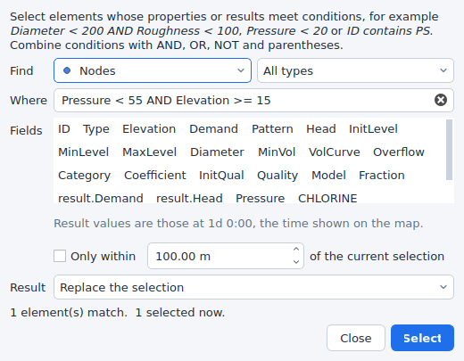

**Tracing.** From the selected nodes, links or subcatchments:

- *Trace downstream* (`D`) and *Trace upstream* (`U`) select everything that water from (or to) the selection passes through. Links are followed in their drawn direction (from node to to node). With results shown and *Select > Trace options > Follow the flow direction of the results* on, links are followed in the direction of their flow at the current time instead, so a trace of a looped EPANET network follows the actual flow paths. This option is on for EPANET models and off for SWMM models, where it honours conduits with negative flow. Upstream traces of SWMM models include the subcatchments that drain to the nodes reached; downstream traces from a subcatchment start at its outlet.
- *Select connected* selects every element that can be reached from the selection in any direction.
- *Stop at closed links* (on by default) stops traces at closed pipes, pumps and valves: closed in the input file, or closed at the current time when results are shown.
- *Select shortest path* selects the shortest path by length between the first and the last selected node, and *Profile along the path* opens the profile plot for it. The profile plot also starts with the first and last selected node when two or more are selected.

**Editing many elements.** When the selected elements are all of one type, *Properties* shows the values they share. Values that differ show as *(mixed)*. A new value applies to every selected element as one step that *Undo* reverses. End nodes are not edited together. *Delete* removes every selected element as one step, and *Edit > Reverse link direction* swaps the end nodes of the selected links (SWMM conduits also swap their inlet and outlet offsets and their entry and exit losses). *Select > Export selection (CSV)* (also in *File > Export*) writes the IDs, types and properties of the selection, and its results at the current time. *Tools > Elevations from DEM* can update only the selected nodes.

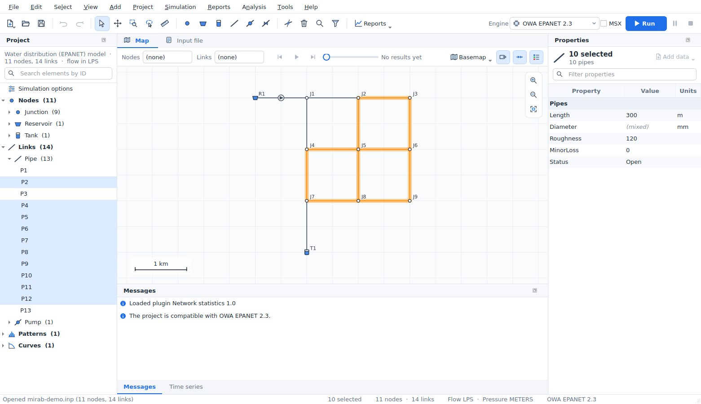

**Splitting a pipe or conduit.** The split tool (`K`, *Edit > Split a pipe or conduit*) splits the pipe or conduit you click at the point closest to the click, as one undoable step:

- a new junction is placed there, and the second part becomes a new link (named after the original, for example `P12_2`) with the same properties and attached data;
- the length is divided in proportion to the drawn length, and each part keeps the bends that lie on it;
- EPANET: the junction elevation is interpolated between the end nodes and its demand is zero; the minor loss stays with the first part;
- SWMM: the junction invert is the conduit invert at that point, taking inlet and outlet offsets into account (depths or elevations, as *LINK_OFFSETS* says); its maximum depth reaches the rim interpolated between the end nodes. The first part keeps its inlet offset, the second its outlet offset. Entry losses and the flap gate stay with the first part and exit losses go to the second; street inlets stay on the original conduit.

**Measuring.** *Tools > Measure distance* (`M`) and *Measure area* (Shift+M) measure on the map: click points, then double-click or press Enter to finish. The length, last segment, area and perimeter are shown next to the cursor in metres and kilometres (hectares) or feet and miles (acres), following the project's units. Projected coordinates are measured in the plane of the coordinate system; geographic coordinates (longitude and latitude) on the WGS 84 ellipsoid. Without a coordinate system, values are in map units.

## Importing GIS and CAD data

*File > Import* reads ESRI shapefiles (`.shp` with `.dbf` and `.prj`), DXF drawings and CSV tables. You can also drop these files on the window.


1. Choose a layer. A shapefile has one layer. A DXF drawing has one layer per drawing layer and geometry type.
2. Choose what its features become:
   - **Points** become nodes, such as junctions, tanks or outfalls.
   - **Lines** become links, such as pipes or conduits.
   - **Polygons** become subcatchments in SWMM models.
3. Choose the ID field, or let Mirab generate IDs with a prefix.
4. For links, line ends within the *snap tolerance* connect to existing nodes, and new nodes are created for the others. Alternatively, choose the fields that hold the start and end node IDs; a CSV table of pipes needs no coordinates this way.
5. Map attribute fields to properties such as elevation, diameter, roughness or length. Mirab suggests fields with common names, and computes lengths and subcatchment areas from the geometry when no field is chosen.
6. When the file has a `.prj`, its coordinate system is shown:
   - If the project already has a coordinate system, the points are reprojected to it.
   - If not, *Use it as the coordinate system of the project* sets it, which also enables basemaps.

Import several layers in a row, for example junctions, then pipes, then tanks. Every import is one undoable step, and notes about skipped or invalid features appear in *Messages*.

## Basemaps and coordinate systems

The *Basemap* button on the map bar shows a web map under the network. The choices are OpenStreetMap, Esri streets, satellite imagery, topographic and light-gray maps, and OpenTopoMap. Tiles are cached on disk, so places you have visited load quickly and work offline. The attribution of the map provider is shown at the bottom right.

Basemaps need to know where the coordinates are on Earth. Use *View > Coordinate system* (or the basemap menu) to choose the coordinate reference system of the node coordinates:

- **Searching:** search about 1,950 built-in systems by name or EPSG code. They include WGS 84 and Web Mercator, every UTM zone, all NAD83 State Plane and county systems in metres and feet, ETRS89, GDA, SIRGAS and others.
- **Other definitions:** type an EPSG code, PROJ string or WKT, or load the `.prj` file of a shapefile.
- **Checking:** the dialog shows where the first node would be in latitude and longitude, so a wrong choice is easy to spot.

Coordinates that are plain longitude and latitude are recognised automatically. Datum shifts are not applied, so data on older datums such as NAD27 can appear tens of metres away from the basemap. The coordinate system is also written into GeoPackage and GeoJSON exports.

The example `examples/epanet/mirab-demo-longbeach.inp` is placed in downtown Long Beach, California, in NAD83 / California zone 5 State Plane coordinates (US survey feet, EPSG:2229). It uses US customary units and opens with an OpenStreetMap basemap.

## Rasters and map services


### Raster layers

*View > Raster layers* (also in the basemap menu) adds elevation models and georeferenced images under the network. Mirab reads them itself, with no GDAL or other software:

- **GeoTIFF** (`.tif`, `.tiff`), including BigTIFF, in strips or tiles, uncompressed or compressed with Deflate, LZW or PackBits (with or without a predictor), with 8 to 64-bit integer or floating-point values. Files saved with JPEG, LZMA, ZSTD or WebP compression are not read; save them again with Deflate or LZW.
- **ESRI ASCII grids** (`.asc`).
- The coordinate system comes from the GeoTIFF keys (EPSG codes and the common user-defined projections) or from a `.prj` file next to the raster. A world file (`.tfw`, `.wld`) places a TIFF that carries no georeferencing.
- The NoData value of the file (`GDAL_NODATA`) leaves holes transparent.

Large files are not loaded whole: Mirab reads only the parts it draws and keeps a small cache. Files with internal overviews draw faster when zoomed out.

Each layer has a style and an opacity:

| Style | Use |
|---|---|
| Hillshade | Shading of the relief over the basemap; flat ground stays clear. Raise *Hillshade exaggeration* for flat towns. |
| Colour ramp | Low ground green, high ground brown. |
| Colour ramp with hillshade | Both together. |
| Image | 8-bit grey, RGB, RGBA or palette images (aerial photos, scanned plans). |

Layers are reprojected to the project's coordinate system as they are drawn, and are drawn in list order (later layers cover earlier ones). *Elevation units* tells Mirab the units of the values when the file does not declare them: metres are assumed, or feet when the horizontal units of the raster are feet.

With an elevation layer, the status bar shows the ground elevation under the cursor in project units, and the profile plot adds the ground line along the path.

A GeoTIFF chosen with *View > Backdrop image* becomes a raster layer. Other images keep working as before with a world file.

### Elevations from a DEM

*Tools > Elevations from DEM* sets node elevations from a digital elevation model.


1. Choose the DEM: an elevation layer of the project, or any file with *Browse*. A file from *Browse* can be added to the map at the same time.
2. Check *Elevation units*. Values are converted to the project's units (metres or feet).
3. Choose the nodes: all, only those with a zero value, or only the selected nodes.
4. Choose the values:
   - **EPANET:** junction and tank elevations, and optionally the total head of reservoirs.
   - **SWMM:** the ground is the rim of junctions and storage units. Either the invert is set to the ground minus the maximum depth, or the maximum depth is set to the ground minus the invert. Outfalls and dividers are left unchanged.
5. The table previews the current value, the ground and the new value of every node. Nodes outside the DEM or on NoData are listed and left unchanged.
6. *Apply* changes the input file as one step that *Edit > Undo* reverses.

The node coordinates are reprojected to the coordinate system of the DEM when both are known. Elevations are interpolated between the four nearest cells.

The same is available from the command line:

```
mirab-cli elevations model.inp --dem terrain.tif                  # preview
mirab-cli elevations model.inp --dem terrain.tif --out model.inp  # write
mirab-cli elevations model.inp --dem terrain.tif --mode missing --reservoirs --dem-units ft --out model.inp
mirab-cli elevations sewer.inp --dem terrain.asc --swmm depth --out sewer.inp
```

`--mode` is `all`, `missing` or `selected` (with `--nodes ID,ID`), `--swmm` is `invert` or `depth`, `--dem-units` is `auto`, `m`, `ft` or `usft`, and `--crs` overrides the project's coordinate system. `--json` prints the table as JSON.

### Map services

Besides the built-in basemaps, *Add map service* in the basemap menu uses any of:

- **Tile address templates (XYZ)** such as `https://tiles.example.org/{z}/{x}/{y}.png`, with `{s}` for subdomains and `{-y}` for TMS row order. The tiles must be in Web Mercator.
- **OGC WMS** (1.1.1 and 1.3.0). Enter the service address and press *Load layers*: Mirab reads the capabilities and lists the layers, styles, formats and coordinate systems. Maps are requested in Web Mercator when the server offers it, otherwise in the project's coordinate system.
- **OGC WMTS** (1.0.0), with tile matrix sets in Web Mercator, the project's coordinate system or longitude/latitude.

Tiles go through the same disk cache as the built-in basemaps. Added services are kept in the application settings; a project that uses one also stores its definition, so it shows the same basemap on another computer. *View > Basemap > Remove* deletes the current service from the list. Problems such as an unreachable server are shown in red at the bottom of the map.

## Choosing an engine

The engine box on the tool bar lists the engines for the model type. Engines that are not installed are disabled; *Project > Simulation engines* explains why.

SWMM5+ is an optional engine. Open *Project > Simulation engines* and click *Install SWMM5+*: Mirab downloads it, checks every file and adds it to the engine box. Without internet access, download the files for your computer from the swmm5plus-capi release page and use *Install from file...*. See [engines.md](engines.md#installing-swmm5) for details.

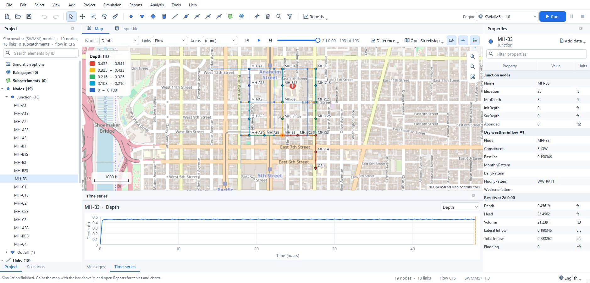

- **MSX:** for EPANET models, tick *MSX* to run EPANET-MSX on top of the selected EPANET engine, and choose the `.msx` file.
- **Messages:** the panel always shows how the project fits the selected engine.
  - **Information:** the project is fully supported.
  - **Warning:** this engine ignores a feature. Mirab removes it from the copy sent to the engine and tells you.
  - **Error:** the engine cannot run the project, and the Run button is disabled.
- **Greyed-out data:** data the selected engine does not model is greyed out in *Properties*. For example, the `[LEAKAGE]` rows of a pipe are greyed out under EPA EPANET 2.2, and PCV is not offered as a valve type.

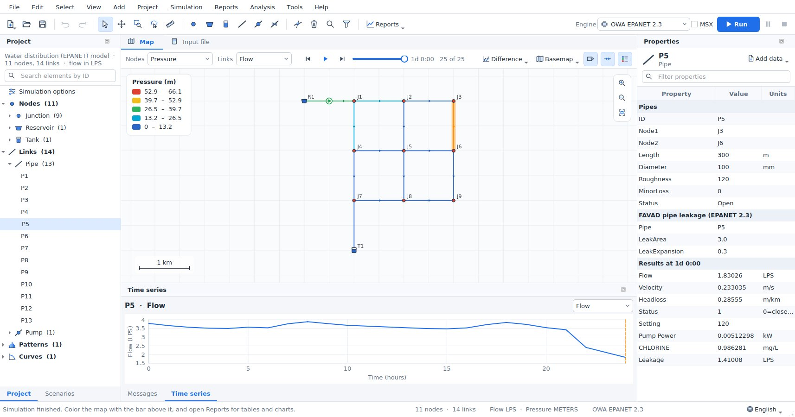

The choice of engine, the MSX file, the coordinate system, the basemap (with the definition of a custom map service), the raster layers, the backdrop, and the observed data and calibration set-up are saved next to the model in `<model>.inp.mirab.json`.

## Running and viewing results

Press `F5` or *Run*. The engine runs in a separate process, so you can keep working.

- **Live results:** the map, the legend, the time controls and the Time series panel fill in while the simulation runs. The time slider covers the periods computed so far and follows the latest one until you move it; the map bar shows how far the run has got. Several times a second the newest period arrives; the complete results replace these when the run ends. Values an engine cannot report during the run (for SWMM 5.2: link volumes, groundwater, snow and pollutants) show as *n/a* until then.
- **Pause:** `F6` or *Pause* holds the engine between two time steps; the status bar shows *Paused at* the simulation time reached. Press it again to resume.
- **Stop:** *Stop* ends the run. The periods computed so far stay on the map, marked *Partial results (cancelled at ...)*. Partial results are not saved; the `.anr` file of the last complete run is kept.


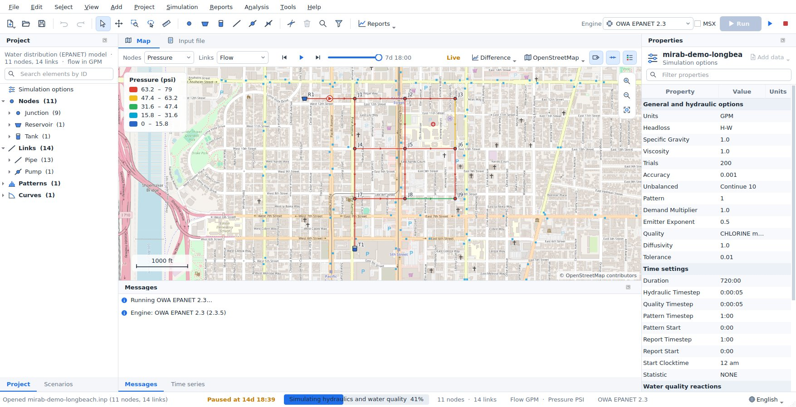

When the run finishes:

- **Map colors:** the map colors nodes, links and subcatchments by the results chosen on the map bar, with a legend and flow-direction arrows.
- **Time controls:** the time controls step through the reporting periods or animate them.
- **Hover:** hovering over an element shows its results at the current time.
- **Properties:** *Properties* lists the selected element's results under its input data.
- **Time series:** the Time series panel plots the selected element over time. Right-click the chart to copy it, save it as an image or copy its data.
- **Saved results:** results are saved as `<model>.anr` and reload when the model is opened again.

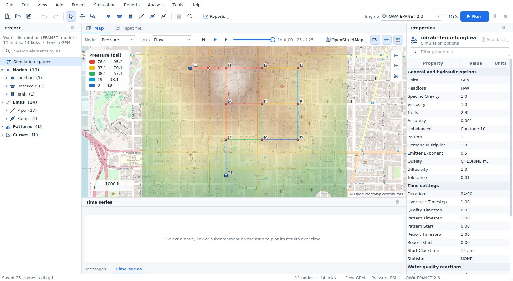

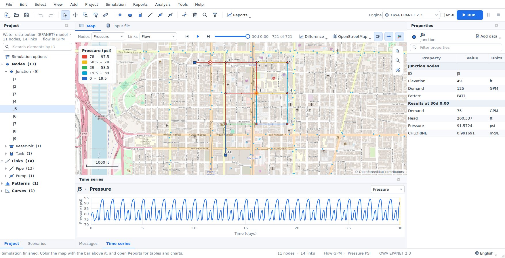

*Simulation > Load results* also opens binary output files (`.out`) written by EPANET or SWMM elsewhere.

## Reports

The *Reports* menu and tool bar button open report tabs. Each report follows new results, and most follow the time slider. Every report can export CSV.

| Report | What it shows |
|---|---|
| Network tables | Properties and results of every node, link or subcatchment at the current time. Sort by any column and filter with expressions such as `Pressure < 20` or `Diameter >= 300 AND Roughness < 100` (the select by query expressions). Selecting a row selects the element on the map. |
| Time series | One result for several elements on one chart. |
| Profile plot | Ground or invert elevation and the hydraulic grade along the shortest path between two nodes (the first and last selected node, when two are selected), with the minimum-maximum range over the simulation. With an elevation layer, the ground from the DEM is drawn along the path; SWMM profiles also show node rims and conduit crowns. |
| Frequency plot | The distribution of a result over all elements at one time, with minimum, median, mean and maximum. |
| Variability plot | The minimum, 10th-90th percentile band, median, mean and maximum of a result over all elements (or one type) at every time. |
| System flow | EPANET: water supplied by reservoirs, consumed by demands and stored in tanks. SWMM: runoff, outfall discharge and flooding. |
| Energy report | EPANET pumps: utilization, average efficiency, energy per volume pumped, average and peak power, energy and cost per day. |
| Calibration | Every observed series against the simulation: a goodness-of-fit table and, for the selected series, a time-series chart and a 1:1 scatter plot. See [Calibration](#calibration). |
| Scenario comparison | Results of the base model and its scenarios side by side; see [Comparing scenarios](#comparing-scenarios). |
| Status report | The engine's own report file. |

*Reports > Fire flow analysis* opens the fire-flow capacity analysis of the resilience tools.


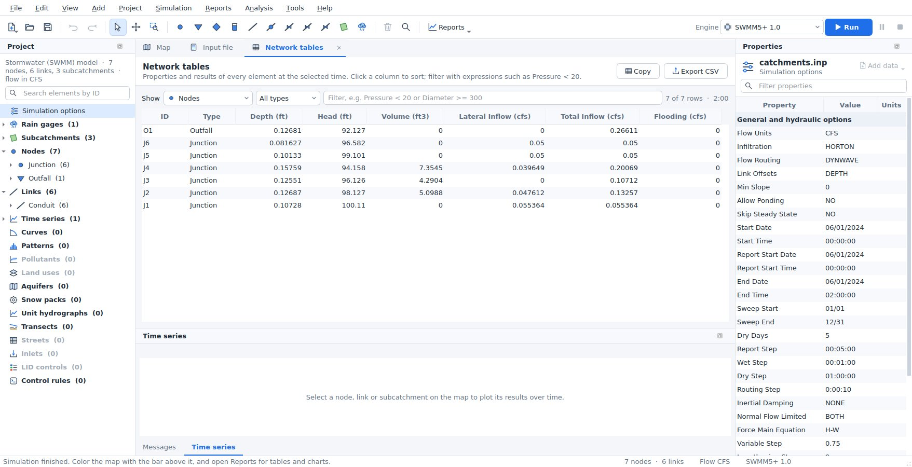

## Scenarios

A scenario is an alternative of the model: larger pipes, more demand, another storm, another pump schedule. Mirab keeps the `.inp` file as the base model and stores each scenario as a list of changes in the settings file next to it (`<model>.inp.mirab.json`), so the input file stays the one the engines and other programs read.

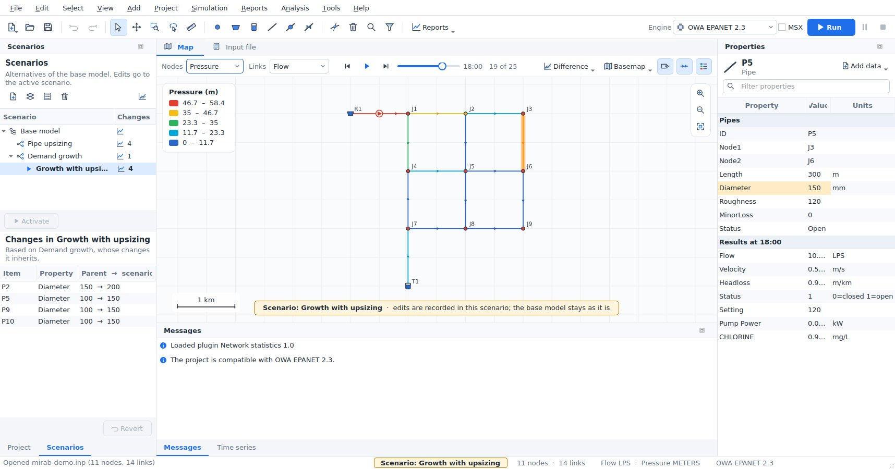

**Creating scenarios.** Open the *Scenarios* panel (left, behind *Project*, or *Project > Scenarios panel*). *New scenario* asks for a name, a description and the scenario it is *based on*: the base model, or another scenario whose changes it inherits (for example "Growth with upsizing" based on "Demand growth"). Each scenario can also use another engine or another EPANET-MSX file. *Duplicate*, *Properties* and *Delete* work on the selected scenario; deleting a scenario that others are based on keeps their models, as they take over its changes.

**Editing a scenario.** Double-click a scenario (or *Activate*) to make it the active one. While a scenario is active:

- the map, the Properties panel, the editors and the *Input file* tab show the scenario's model,
- every edit, wherever it is made, is recorded as a change of that scenario and the base model stays as it is,
- the map shows a banner, the status bar and the window title name the scenario, and values that differ from the base model are highlighted in *Properties*, with the base value in their tooltip,
- the engine selector chooses the scenario's engine,
- *Run* saves the results as `<model>.<scenario>.anr` (and `.rpt`), so each scenario keeps its own results; switching scenarios switches the results shown.

The lower half of the panel lists the changes of the active scenario: the element or option, the property, and the parent value and the scenario value. Double-click a change to select its element; *Revert* removes the selected changes. Undo and redo work as usual: undoing an edit made in another scenario (or in the base model) first switches to it. Edits of several selected elements, deletions, splits and reversed links are recorded like any other edit; the selection stays when you switch scenarios, for the elements that exist in both. With several elements selected, a highlighted value is changed by the scenario for at least one of them. Choose *Base model* and *Edit the base model* to change the input file itself; scenarios follow, because they store differences only.

**When the base model changes.** Changes find their rows by element ID (and the row number among rows of the same element, for patterns or demand categories) and by option name, not by line number, so adding or reordering elements in the base model does not disturb them. A change whose element was removed from the base model, or whose base value was edited after the scenario changed it, is a *conflict*: it is marked with a warning in the change list, with the reason in its tooltip. The scenario's value wins over an edited base value; a change whose element is gone is skipped until you revert it.

**Running several scenarios.** *Simulation > Run scenarios* (or the run button of the panel) runs the checked scenarios, each in its own solver process, several at the same time (*Simultaneous runs*). Each row shows its progress; results are saved next to the project. The dialog works on the models as they are in the window, saved or not.

### Comparing scenarios

*Reports > Scenario comparison* (or the chart button of the Scenarios panel) compares the scenarios that have results. The first checked scenario is the reference; the others are compared with it.

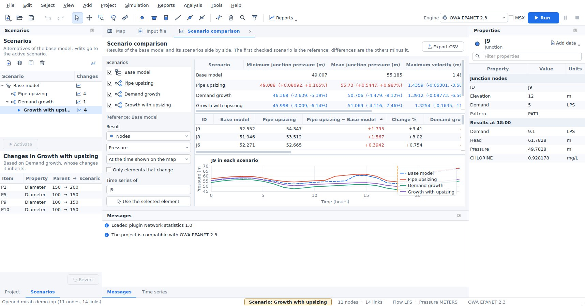

- **Key figures:** EPANET: minimum and mean junction pressure, maximum velocity, demand volume and pump energy. SWMM: peak node flooding, flooding volume, peak outfall flow, outfall volume, peak runoff and the largest link capacity used. Volumes and energy add up the reporting periods. Changes from the reference are given as values and percentages.
- **Table:** one result of every node, link or subcatchment in each scenario, at the time shown on the map or as its maximum, minimum or average over time, with the difference from the reference and the change in percent. Sort by any column; *Only elements that change* hides the rest. Selecting a row selects the element and plots it.
- **Chart:** the time series of one element in every scenario on one chart.
- **Export CSV** writes the key figures and the table.

**Difference map.** *Difference* on the map bar colors the map by the change from another scenario's results: the active scenario minus the chosen one, at the time shown, for the results chosen on the map bar (for links, the change in magnitude). Blue is a decrease, red an increase and grey (within 5 % of the largest change) about the same. Print layouts, report documents and animations show the map as it is colored, so they show the difference too.


**Command line and Python.** `mirab-cli scenarios list model.inp` lists the scenarios, `mirab-cli scenarios export model.inp --scenario NAME --out alt.inp` writes a scenario's input file, `mirab-cli run model.inp --scenario NAME` runs one, and `mirab-cli batch model.inp [--scenarios "Base,A,B" | --all] [--jobs N]` runs several in parallel processes. `--scenario` also works with `info`, `check`, `model get`, `calibrate`, `export` and the resilience analyses; `model set --scenario NAME` records its edits as changes of the scenario. See [cli.md](cli.md#scenarios). In Python, `mirab.Project.open("model.inp", scenario="NAME")`, `mirab.run(..., scenario="NAME")` and `mirab.scenarios("model.inp")` do the same ([python.md](python.md#scenarios)).

The examples have scenarios: pipe upsizing, demand growth and both together for `epanet/mirab-demo.inp`; a 10-year storm and a 10-year storm with a larger trunk sewer for `swmm/mirab-urban.inp`, whose base model carries the 2-year storm.

## Printing and exporting

*File > Export* has three deliverables besides the CSV and GIS exports. They all use the map as it is shown: the current view, result colors, labels, basemap (web tiles, WMS or WMTS) and raster layers such as a hillshade.

### Print layout

*Print layout* composes one page with the map and its furniture, with a live preview:

- **Templates.** *Legend beside the map* puts the legend (result classes and element symbols), the north arrow, the scale bar and your notes in a sidebar. *Chart or table below the map* places the legend, north arrow and scale bar inside the map frame and shows a chart or table from a report under it, for example the system flow or the variability plot. Open report tabs keep the elements and results chosen in them.
- **Page.** A4, A3, Letter or Tabloid, portrait or landscape. *Map size* moves the split between the map and the sidebar or chart.
- **Texts.** Title, subtitle, date, notes and an optional logo image. The footer shows the coordinate system and the map scale at the chosen paper size.
- **Output.** *Export PDF* writes vector graphics (the network, legend, charts and text stay sharp at any zoom; the basemap is one embedded image at about 200 dpi). *Export PNG* writes an image at 150, 300 or 600 dpi. *Print* sends the page to a printer.

Basemap tiles are downloaded at the resolution of the output before the file is written, which can take a few seconds the first time.


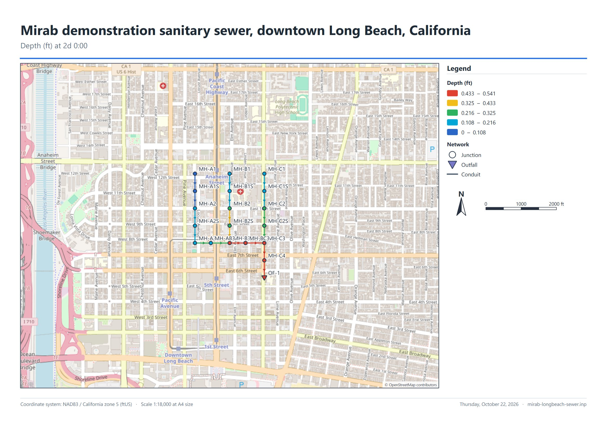

### Report document

*Report document* assembles a multi-page document with a cover, a table of contents and numbered sections. Tick the sections to include:

- **Project summary**: title, file, model type, engine, units, element counts, simulation duration and time steps, demand model and coordinate system.
- **Simulation status**: engine, reporting periods, SWMM continuity errors (runoff, flow routing and quality routing, rated good up to 1 %, acceptable up to 10 %) and the engine's messages.
- **Map**: the current map view with its legend, scale bar and north arrow.
- **Reports**: any of the report tabs, with their statistics, charts and tables. The calibration report adds the goodness-of-fit table and charts when the project has observed data; the scenario comparison adds the key figures of each scenario, the element table and the chart. Long tables are cut after the number of rows you choose; export the report as CSV for all rows.

*Export PDF* lays the document out on A4 or Letter pages with page numbers; charts and the network are vector graphics. *Export HTML* writes one self-contained web page (charts and the map are embedded images) that opens in any browser and can be e-mailed as a single file.

### Results animation

*Results animation* saves the map coloring over the reporting periods, with a title, a time stamp, the legend, a scale bar and a north arrow:

- **Animated GIF**: one palette of up to 255 colors shared by all frames, optional dithering so basemap imagery keeps its shading (the flat colors of the network are never dithered), and only the changed part of each frame is stored, so files stay small. The animation loops.
- **PNG image sequence**: numbered files `name_0001.png`, `name_0002.png`, ... for video editors and slides.

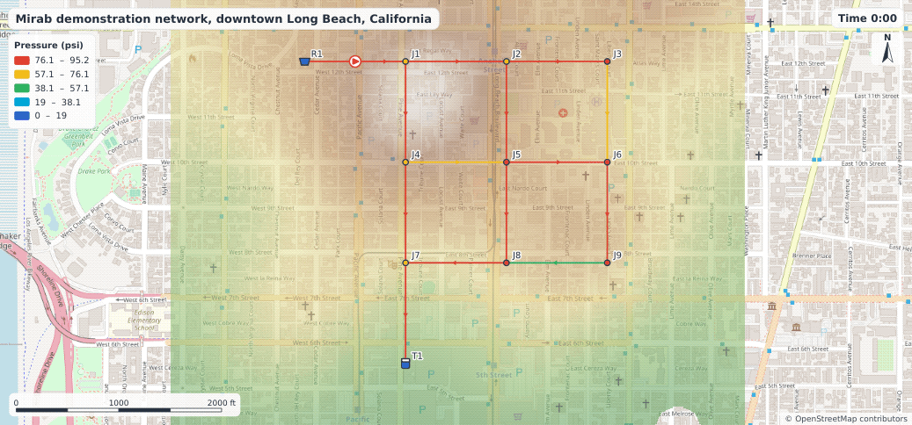

Choose the periods (from, to and every n-th), the speed in frames per second, the size (the map view or a fixed size such as 1280 x 720) and whether to show the basemap. The frames are drawn a few at a time while a background thread writes the file, so the window stays responsive; *Cancel* stops the export and removes the partial output.

## Patterns, curves and time series

Double-click a pattern, curve or time series in the *Project* panel to edit it in a tab. The tab shows a table of values next to a chart that updates while you type. *Apply* writes the changes as one undoable step, and *Revert* discards them.


## Stormwater data (SWMM)

Everything in a SWMM 5.2 input file can be edited without the text view.

- **Named objects.** The *Project* panel lists pollutants, land uses, aquifers, snow packs, unit hydrographs, transects, streets, inlets, LID controls and control rules, with their counts. Right-click a group to add an object, or an object to rename or delete it. Renaming updates every reference (a renamed pollutant changes its inflows, dry weather flows, buildup, washoff, initial loadings and treatment expressions). Deleting removes the data that cannot exist without the object, such as the inflows of a deleted pollutant or the buildup of a deleted land use, and clears optional references such as a co-pollutant. Undo restores everything.
- **Object editor.** Double-click an object to edit it in a tab. Each value has its own field with its units, and a tooltip with the SWMM name and meaning; choices and references to other objects, time series, patterns and curves are drop-down lists. A land use shows its buildup and washoff functions for every pollutant in tables. Snow packs show one box per surface (plowable, impervious, pervious, removal) and inlets one box per part, so a combination inlet has a grate and a curb opening. *Apply* writes the changes as one undoable step. Unit hydrographs, transects, LID controls and control rules have their own editors, described below.
- **Element data.** In *Properties*, the data attached to a node, link or subcatchment appears under its own heading: external inflows ([INFLOWS]), dry weather inflows ([DWF]), RDII, treatment, groundwater and its flow expressions, land use coverage, initial buildup and inlet usage. Each value has a name and units; references offer the existing objects.
- **Checks.** *Project > Check compatibility* (also run when a project opens or the engine changes) reports references to objects that do not exist (an inflow of an unknown pollutant, a coverage of an unknown land use, a groundwater outlet that is not a node) in *Messages*.
- **Engine support.** Data the selected engine does not simulate is greyed out with the reason, for example pollutants, LID controls, streets and inlets with SWMM5+. The data stays in the input file.

The example `examples/swmm/mirab-quality.inp` uses pollutants, land uses, buildup and washoff, external and dry weather inflows, treatment, groundwater and RDII.

## Simulation options

*Project > Simulation options* (or a double-click on *Simulation options* in the *Project* panel) opens a dialog with one page per topic:

- **SWMM:** general settings (flow units, infiltration model, routing method, link offsets, ponding, steady periods, and which process models run), analysis and reporting dates, time steps, dynamic wave settings, interface files ([FILES]: hotstart, rainfall, runoff, RDII, inflows and outflows), reporting ([REPORT]), evaporation (constant, monthly, time series, temperature or climate file, with a soil recovery pattern), temperature, wind speed and snowmelt ([TEMPERATURE]), and monthly adjustments ([ADJUSTMENTS]).
- **EPANET:** hydraulics and demands, water quality and reactions, times, energy and reporting.

Dates and times use calendar and clock fields; choices use drop-down lists. Only the values you change are written, as one undoable step, and options the dialog does not show are kept. The *Properties* panel still lists the options as plain rows when nothing is selected.

## LID controls, transects, unit hydrographs and control rules

These SWMM sections have their own editors. They open in a tab like the pattern editor, with *Revert* and *Apply* in the header and a list of problems at the bottom that updates while you type. *Apply* is disabled while there are errors, except for control rules, which can be applied unfinished. Renaming an object also updates the rows that use it ([LID_USAGE], irregular [XSECTIONS], [RDII]). Lines and comments of other objects in the section are kept as they are.

**LID controls** ([LID_CONTROLS]). Choose the type (bio-retention cell, rain garden, green roof, infiltration trench, permeable pavement, rain barrel, rooftop disconnection or vegetative swale); only the layers that type uses are shown: surface, pavement, soil, storage, drain, drainage mat and pollutant removals. Each value shows its unit, and a description appears below the form when you click it. The drawing on the right is a cross-section of the layers (heights are indicative, not to scale) with the drain at its offset height, and it changes as you type. The checks follow SWMM: for example the field capacity must be below the porosity, the wilting point below the field capacity, and a drain's open level above its closed level.


**LID usage** ([LID_USAGE]). Right-click a subcatchment on the map or in the *Project* panel and choose *LID usage...*. The dialog lists the LID units of the subcatchment: control, number of units, area and width of each unit, initial saturation, the percentages of the impervious and pervious areas treated, whether the outflow goes to the pervious area, the drain outlet and an optional report file. Below the table, the total LID area is compared with the subcatchment area; above 100 % the line turns red, because SWMM stops with an error.

**Transects** ([TRANSECTS]). Enter the stations and elevations from left to right looking downstream (Ctrl+V pastes two columns from a spreadsheet), the Manning's n of the left overbank, channel and right overbank, the bank stations and the modifiers (stations factor, elevation offset, meander factor). The chart shows the section with the modifiers applied, the banks as dashed lines and a water surface whose depth you set with the slider; the line below the chart gives the flow area, top width, wetted perimeter and hydraulic radius at that depth. Several transects can share the section; when a transect takes its n values from the one above it, Mirab keeps that working when you change the one above.

**Unit hydrographs** ([HYDROGRAPHS]). Choose the rain gage, then a month on the left (*All months* or January to December) and enter R, T and K of the short, medium and long-term responses, with the optional initial abstraction depth, recovery rate and initial value. Months with their own values are shown in blue; the others use the *All months* values. The chart shows the three triangular hydrographs of the month and their total.

**Control rules** (SWMM [CONTROLS], EPANET [RULES] and simple [CONTROLS]). Open them from *Project > Control rules*. The list on the left has one entry per rule, plus *Variables and notes* for the lines before the first rule (SWMM `VARIABLE` and `EXPRESSION` definitions go there). The selected rule is shown with syntax colors; lines with errors are underlined, and each problem names the rule and line. Rules are checked as SWMM 5.2 checks them: clause order (IF, AND, OR, THEN, ELSE, PRIORITY), object types and their attributes, relational operators, values (status words, times, dates, months), settings by number, `CURVE`, `TIMESERIES` or `PID`, named variables and expressions, and whether every node, link, gage, curve and time series exists and has the right type. *New rule* inserts a template (pump on and off by wet-well depth, orifice by time of day, weir by flow, control curve, PID controller, named variable); *Rule builder* composes a rule from lists of the model's objects.


`mirab-cli info model.inp` prints the same checks, with the line number in the file for rule problems.

## Resilience tools

*Analysis* offers five analyses for EPANET models: the Todini index, water service availability, network topology, pipe criticality and fire-flow capacity. See [resilience.md](resilience.md) for the methods. Selecting a row in the result table highlights the element on the map.

## Calibration

Mirab compares simulations with measurements and can adjust model inputs until they match. It works the same way for EPANET and SWMM models.

### Observed data

*Project > Observed data* lists the measurement files of the project. *Add files* accepts:

- **Text tables** (`.csv`, `.tsv`, `.txt`): one time column and one or more value columns, separated by commas, semicolons, tabs or blanks. A first row of names is optional; rows starting with `#` are comments. Times can be dates and times (`2024-05-01 13:30`, `2024-05-01T13:30:00`, `05/01/2024 1:30 PM`, `01-May-2024 13:30`, or a date column followed by a time column) or elapsed time since the start of the simulation (`1.5` hours, or minutes, seconds or days, or `36:30`). Choose *Day first* for `DD/MM/YYYY` dates. Empty cells, `NA`, `NaN` and `-` are missing values, and you can add your own marker such as `-9999`. Decimal commas are read when the separator is a semicolon or a tab.
- **EPANET calibration files** (`.dat`): rows of location ID, time (hours or `h:mm`) and value. A row without an ID continues the location above. Text after `;` is a comment.

  ```
  ; Flow in pipes P1 and P13 (L/s)
  P1    0:00   21.2
        1:00   19.4
  P13   1:00   26.9
  ```

- **SWMM calibration files** (`.dat`): a location ID on a line of its own, followed by rows of date, time and value (`01/01/2026 00:15 0.2`) or elapsed days, time and value (`0 00:15 0.2`).

Each column or location becomes a series linked to an element type (node, link or subcatchment), an element ID and a result, such as junction `J5` *Pressure*, pipe `P12` *Flow*, SWMM node *Depth* or outfall *Total Inflow*. Mirab proposes the links from column names such as `J5 Pressure (psi)` or `P1_flow`. Give the unit of the measurements when it differs from the model's (`psi`, `kPa`, `bar`, `m`, `ft`, `in`, `mm`; `GPM`, `LPS`, `L/s`, `CFS`, `CMS`, `m3/s`, `MGD`, `MLD`, `CMH`, `m3/h`; `m/s`, `ft/s`); pressures and heads convert through metres of water. The weight sets how much a series counts in the calibration objective. The preview shows the selected series over the simulated result.

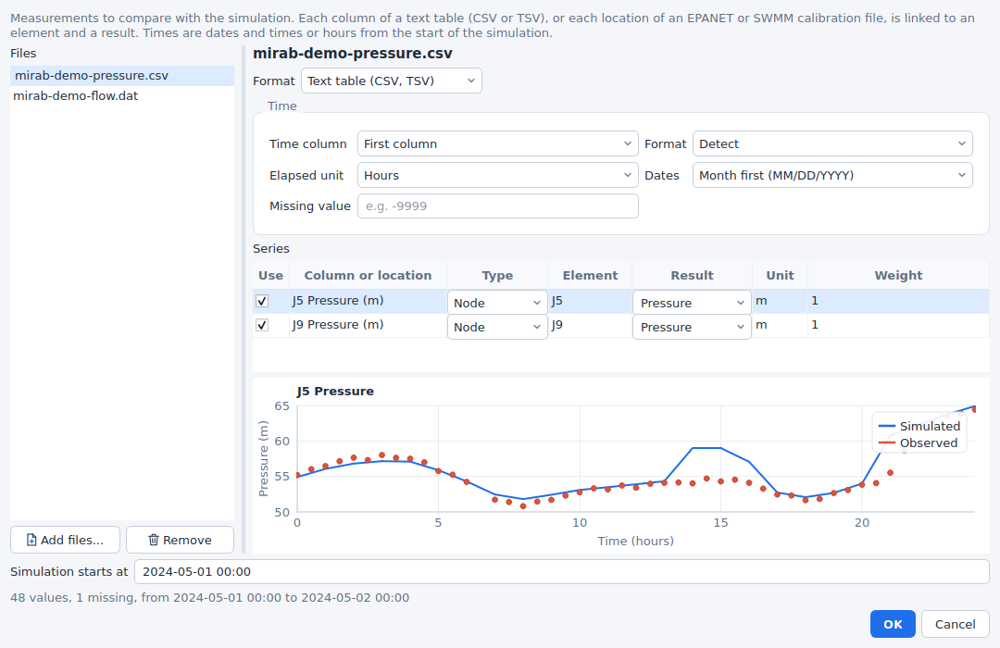

Times have no time zone. Dated measurements are placed on the simulation clock with the start date: SWMM models use `START_DATE` and `START_TIME`; EPANET models start at their start clock time on the day of the first measurement, unless you enter *Simulation starts at*. Measurements outside the simulated period are left out.

The list is saved with the project in `<model>.inp.mirab.json`, with file paths relative to the model. Once linked, measurements appear as markers in the Time series panel and the Time series report.


### Goodness of fit

*Reports > Calibration* aligns each series with the simulation: the simulated result is interpolated linearly at every measurement time. The table, which sorts by any column and exports CSV, gives:

| Metric | Definition (observed *o*, simulated *s*, means *ō*, *s̄*) | Best |
|---|---|---|
| NSE | Nash-Sutcliffe efficiency, 1 - Σ(s - o)² / Σ(o - ō)² | 1 |
| KGE | Kling-Gupta efficiency (2012), 1 - √((r - 1)² + (β - 1)² + (γ - 1)²) with correlation r, bias ratio β = s̄/ō and ratio of the coefficients of variation γ | 1 |
| PBIAS | Percent bias, 100 Σ(s - o) / Σo; positive values mean the model over-predicts | 0 |
| RMSE, MAE | Root mean square error and mean absolute error, in result units | 0 |
| R² | Square of the Pearson correlation | 1 |
| Peak error | Simulated peak minus observed peak, in percent of the observed peak | 0 |
| Peak timing | Time of the simulated peak minus time of the observed peak, hours | 0 |
| Volume error | Difference of the volumes under the two series (trapezoidal rule), in percent; flows only | 0 |

Cells are coloured by quality bands: NSE above 0.75 very good, 0.65 good, 0.50 satisfactory; PBIAS within ±10 % very good, ±15 % good, ±25 % satisfactory (Moriasi et al., 2007); R² above 0.85, 0.75, 0.60 (Moriasi et al., 2015); KGE above 0.75, 0.60, 0.50; volume error within 5, 10, 20 %; peak error within 10, 20, 30 %. The rating column combines NSE and PBIAS. Selecting a row plots the series over time, with the measurements as markers, and as a scatter plot with the 1:1 line and the least-squares fit.


### Automated calibration

*Project > Calibrate* adjusts model inputs to minimise an objective:

- **Parameters.** Each parameter is a numeric column of a section (for example `[PIPES]` *Roughness*, `[CONDUITS]` *Roughness*, `[SUBCATCHMENTS]` *PctImperv* or `[JUNCTIONS]` *Demand*) for all its rows or for listed element IDs (*Use selected element* adds the element selected on the map). *Multiply* scales the current values by a factor between the minimum and maximum; *Replace* sets the value itself. The *Rows* column shows how many rows a parameter changes.
- **Objective.** A weighted sum over the series (each with its weight) of chosen metrics: NSE, KGE and R² count as 1 minus the value; PBIAS, peak error and volume error as their size in percent divided by 100; RMSE and MAE in result units; peak timing in hours. Metrics that do not apply to a series (volume error of a pressure) are left out.
- **Runs.** The number of model runs, how many run in parallel and the random seed.

The search is Dynamically Dimensioned Search (Tolson and Shoemaker, 2007): it starts from the current model, then perturbs a random subset of the parameters of the best set found so far, a subset that shrinks as the runs are used up. It suits budgets from a few dozen to a few thousand runs. *Sensitivity screening* instead runs a Latin hypercube sample of the parameter ranges and reports the rank correlation of each parameter with the objective.

Every run writes a modified copy of the model and simulates it in its own `mirab-cli` process, so an engine failure ends that run only. The chart shows the objective of each run and the best so far; *Cancel run* stops the runs in progress. When it finishes, *Apply best parameters* writes the best values into the model as one edit, which *Undo* reverts. Each calibration also leaves a folder `<model>-calibration` next to the model with `evaluations.csv` (every run: objective, parameter values and the first metric of each series), `best.json` (the best values and their metrics) and `<model>-best.inp`.


### Try it

The examples include measurements of models that differ from the examples in known ways:

- `epanet/mirab-demo.inp`: pressures at J5 and J9 every 30 minutes (`mirab-demo-pressure.csv`) and flows in P1 and P13 (`mirab-demo-flow.dat`), measured with pipe roughness coefficients 15 % below the model's. Calibrating *Pipe roughness* should find a multiplier close to 0.85.
- `swmm/mirab-urban.inp`: outfall flow (`mirab-urban-outfall.dat`) and the depth at J3 (`mirab-urban-depth.csv`) of a model with conduit roughness 20 % higher and imperviousness 10 % lower. Calibration finds an imperviousness multiplier close to 0.9; the outfall flow is much less sensitive to the roughness, so its multiplier is found less precisely, as a sensitivity screening shows.

Both measurement sets include noise, so the fit is good but not perfect.

### From the command line

```
mirab-cli calibrate metrics model.inp [--observed calib.json|data.csv|data.dat] [--results model.anr] [--json|--csv]
mirab-cli calibrate model.inp [--config calib.json] [--engine ID] [--jobs N] [--budget N] [--seed N]
                  [--method dds|lhs] [--out-dir DIR] [--start "2024-05-01 00:00"] [--keep-runs]
```

`calibrate metrics` compares existing results (`model.anr`, or `--results`) with the observed data of the project. `calibrate` runs the optimisation with the set-up saved with the project, or with a `--config` file in the same form, and prints each run. The set-up is the `calibration` member of the project file (a `--config` file may also hold it alone):

```json
{
  "observed": [
    {"file": "pressure.csv", "format": "csv", "noData": "-9999",
     "links": [{"column": "J5 Pressure (m)", "table": "node", "element": "J5", "variable": "Pressure", "unit": "m"}]},
    {"file": "flow.dat", "format": "epanet", "table": "link", "variable": "Flow", "unit": "LPS"}
  ],
  "simulationStart": "2024-05-01 00:00",
  "parameters": [
    {"name": "Pipe roughness", "section": "PIPES", "column": "Roughness", "elements": "all",
     "mode": "multiply", "min": 0.6, "max": 1.4}
  ],
  "objective": [{"metric": "NSE", "weight": 1}],
  "budget": 100, "jobs": 4, "seed": 1
}
```

`format` is `csv`, `epanet`, `swmm` or `auto`. Text tables also take `timeColumn`, `timeFormat` (`datetime` or `elapsed`), `timeUnit` (`hours`, `minutes`, `seconds`, `days`) and `dateOrder` (`MDY` or `DMY`). Without `links`, every column is linked by its name. With `--machine`, `calibrate` reports each run as an `evaluation` event (index, objective, best so far, parameter values) and stops on a `cancel` line.

## Water and wastewater together

Most of the water a town delivers comes back through its sewers. When the water distribution model (EPANET) and the sewer model (SWMM) cover the same area, Mirab links them: each water junction with a demand drains to a SWMM node, and the water used there, times a return factor, becomes the node's dry-weather inflow, with the daily rhythm of the demand.

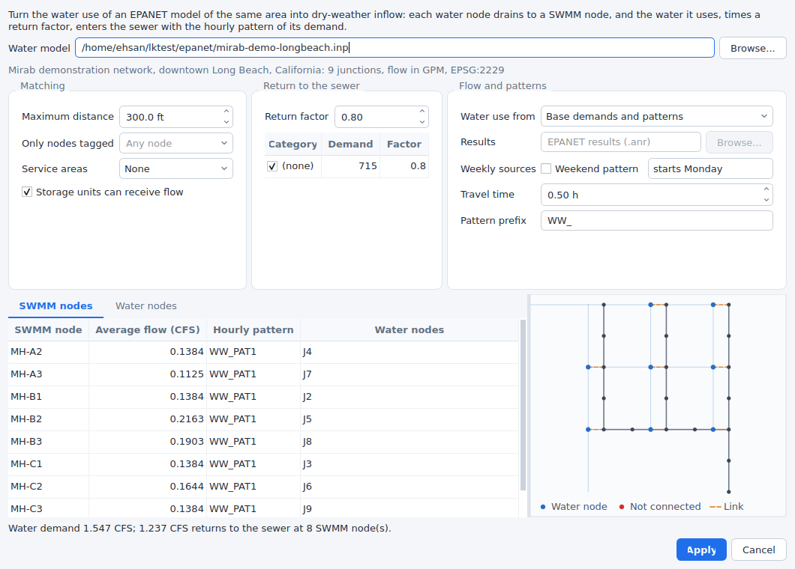

Open the SWMM model and choose *Tools > Wastewater from water model*:

1. **Water model**: the EPANET input file of the same area. Its coordinate system comes from its own project settings; when it differs from the SWMM project's, the water coordinates are reprojected.
2. **Matching**: every water junction with a demand goes to the nearest SWMM junction (or storage unit). *Maximum distance* (in the SWMM map units) leaves farther junctions unconnected, *Only nodes tagged* limits the candidates to SWMM nodes with a tag (`[TAGS]`, for example `Sanitary` in a combined model), and *Service areas* keeps each water junction inside its sewershed: the SWMM subcatchments, or the polygons of a shapefile or DXF drawing. Junctions outside every area are not connected. On the *Water nodes* tab, *Connect to* sends the selected water junctions to a SWMM node of your choice, *Do not connect* leaves them out and *Nearest node* undoes both.
3. **Return to the sewer**: the share of the water that reaches the sewer (0.8 by default) and, per demand category of the EPANET model (`[DEMANDS]`), its own factor; untick a category, such as irrigation, to leave it out.
4. **Flow and patterns**:
   - *Base demands and patterns*: the average flow is the base demand times the mean of its pattern (with the global demand multiplier). The hourly pattern follows the demand pattern by clock hour, taking the pattern time step, pattern start and start clock time of the EPANET model into account, and is scaled to a mean of 1.
   - *Simulation results*: the demand EPANET delivered in a run (an `.anr` file), hour by hour. With pressure-driven demand this is the water actually supplied. Emitter and leakage flows are left out.
   - *Weekend pattern*: when the patterns or results cover a week, weekdays and weekends get their own hourly patterns (`HOURLY` and `WEEKEND`) and the day totals a `DAILY` pattern. Set the day of the week the EPANET patterns start on.
   - *Travel time* delays the patterns by the time the water takes to reach the SWMM node.
   - When several water junctions drain to one SWMM node, their patterns are combined in proportion to their flows. Identical patterns are written once; they are named with the *Pattern prefix* and the EPANET pattern (`WW_PAT1`) or the SWMM node.
5. The tables preview each SWMM node's average flow (in the SWMM flow units), its pattern and the water junctions it receives, and each water junction's SWMM node, distance, demand and returned flow. The map beside them shows the SWMM network, the water junctions and a line to the node each one drains to; unconnected junctions are red. The line below sums up the water demand, the returned flow, and the junctions that are not connected or are farther than the distance.
6. *Apply* writes the `FLOW` rows of `[DWF]` and the patterns as one step that *Edit > Undo* reverses. Other constituents in `[DWF]`, other patterns and the rest of the file are kept; flow rows and patterns written by an earlier apply that are no longer needed are removed. The link (the water model, the options, manual choices and the junctions each node receives) is saved with the project, so the dialog opens with it next time and a changed water model can be applied again.

Once linked, the water network is drawn faintly under the SWMM map, with a dashed line from each water junction to its SWMM node. *View > Water network layer* shows or hides it. In an EPANET project, *View > Sewer network layer* draws a sewer model over the water network; when that sewer model is linked to this water model, the lines appear as well.


### Try it

`examples/swmm/mirab-longbeach-sewer.inp` is a small sanitary sewer in the alleys of the streets of `examples/epanet/mirab-demo-longbeach.inp`, linked to it: 18 manholes, 8-inch to 15-inch pipes and an outfall to a trunk sewer. Its dry-weather inflow comes from the water network with a return factor of 0.8 and half an hour of travel time, so it runs as it is (*Simulation > Run*). Open *Tools > Wastewater from water model* and change the return factor, the distance or the travel time to see the effect, or run the water model with pressure-driven demand and use its results.

### From the command line

```
mirab-cli link dwf sewer.inp --water water.inp                            # preview
mirab-cli link dwf sewer.inp --water water.inp --out sewer.inp            # write
mirab-cli link dwf sewer.inp --distance 300 --return 0.8,Irrigation=0 --lag 0.5 --out sewer.inp
mirab-cli link dwf sewer.inp --use-results water.anr --weekend --week-start Monday --json
```

Options not given come from the link saved with the SWMM project; `--out` saves the link with the written model. See [cli.md](cli.md#water-and-wastewater-link-dwf) for every option and the JSON output, and [python.md](python.md#analyses) for `mirab.link_dwf`.

The link is one-way: the water model sets the sewer inflows. A coupled simulation, in which the sewer would also affect the water network, is not part of Mirab.

## GIS and QGIS

- *File > Export > GeoPackage* writes one layer per element type (junctions, pipes, conduits, subcatchments, ...) with every input value and, when results are loaded, the values of the current period.
- *File > Open in QGIS* writes `<model>.gpkg` and starts QGIS with it. QGIS is never loaded inside Mirab, so a QGIS installation problem cannot affect it. Set the QGIS program in *Tools > Settings* if it is not found.
- *View > Backdrop image* shows a PNG, JPEG or TIFF behind the network. With a world file (`.pgw`, `.jgw`, `.tfw` or `.wld`) the image is georeferenced; without one it is stretched over the network. A georeferenced GeoTIFF becomes a raster layer (see [Rasters and map services](#rasters-and-map-services)).

## WNTR

*File > Export > WNTR network* writes the JSON layout read by `wntr.network.read_json`, in SI units. *File > Import > WNTR network* reads a file written by `wntr.network.write_json` and saves it as an EPANET input file in LPS. Controls, rules and quality sources are reported as not transferred.

## Language

Mirab speaks English, Persian (فارسی), Arabic (العربية), Hebrew (עברית), Spanish (Español), Portuguese (Português do Brasil), French (Français), Italian (Italiano), German (Deutsch), Simplified Chinese (简体中文) and Traditional Chinese (繁體中文). Choose the language with the globe button at the bottom of the window, or in *Tools > Settings > Language*, and restart Mirab when asked (*Restart now* reopens the project). Every language is listed with its English name too, for example "فارسی (Persian)", so a language chosen by mistake is easy to change back; *System default* follows the language of the operating system and falls back to English. `mirab --language fa` (or `ar`, `he`, `es`, `pt_BR`, `fr`, `it`, `de`, `zh_CN`, `zh_TW`, `en`) starts once in a given language without changing the setting. Qt's own dialogs and buttons (file dialogs, *OK*, *Cancel*) follow the same language.

Persian and Arabic use the Vazirmatn font, which is part of Mirab; Hebrew uses the fonts of the operating system. In these three languages the window is laid out from right to left: menus, docks, forms and tables are mirrored. The map, charts, profiles, the LID cross-section and print layouts keep their left-to-right geometry (east and time to the right), and numbers, IDs and values in tables read left to right. The input file text, control rules and query expressions stay left to right too.

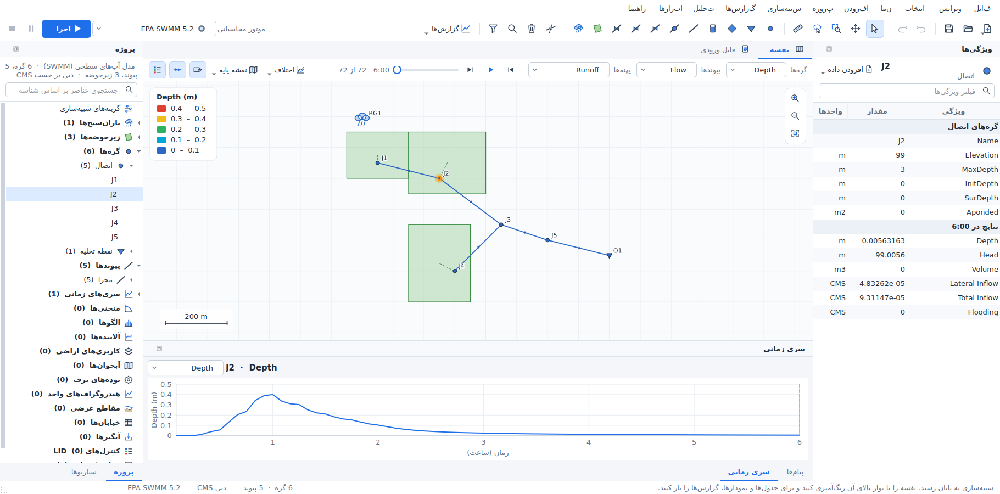

Screenshots of the main window in the other languages: [Arabic](images/language-ar.png), [Hebrew](images/language-he.png), [Spanish](images/language-es.png), [Portuguese](images/language-pt_BR.png), [French](images/language-fr.png), [Italian](images/language-it.png), [German](images/language-de.png), [Simplified Chinese](images/language-zh_CN.png), [Traditional Chinese](images/language-zh_TW.png).

Some names stay in English in every language because they are part of the data: input column names (`Elevation`, `Diameter`, `InitLevel`) and result variable names (`Pressure`, `Flow`, `Depth`), which are also the names used in query expressions such as `Diameter < 200 AND Pressure < 20` and in CSV and GIS exports; `.inp` section and keyword names; unit symbols; and messages that name elements or lines of the input file. `mirab-cli` always prints English.

Numbers keep a decimal point and Latin digits in every language, and the input file is always written the same way, so a model saved in one language opens unchanged in another. Spin boxes and dates follow the regional settings of the operating system.

The translations are maintained in `translations/` of the source tree; [translations/README.md](../translations/README.md) explains how to review them and add a language.

## Keyboard shortcuts

| Key | Action |
|---|---|
| `F5` | Run simulation |
| `F6` | Pause or resume the simulation |
| `F` | Zoom to fit |
| `+`, `-`, arrow keys | Zoom and pan the map |
| `S` | Selection tool |
| `H` | Pan tool |
| `Z` | Zoom to a rectangle |
| `L` | Select with a polygon |
| `M`, `Shift+M` | Measure a distance, an area |
| `K` | Split a pipe or conduit |
| `Shift+F` | Zoom to the selection |
| `Ctrl+A`, `Ctrl+I` | Select all, invert the selection |
| `Ctrl+Shift+F` | Select by query |
| `D`, `U` | Trace downstream, upstream from the selection |
| `Esc` | Cancel the current tool or clear the selection |
| `Delete` | Delete the selection |
| `Ctrl+Z`, `Ctrl+Y` | Undo, redo |
| `Ctrl+F` | Find an element by ID and zoom to it |

## Command-line options

`mirab [file.inp]` opens a project. Other options:

| Option | Effect |
|---|---|
| `--language CODE` | Starts in a language: `en`, `fa`, `ar`, `es`, `zh_CN` or `system` (default: the language chosen in *Tools > Settings*). |
| `--import FILE` | Opens the import dialog for a shapefile, DXF drawing or CSV table. |
| `--show-data SECTION:ID` | Opens the editor of a pattern, curve, time series, named object, LID control, transect or unit hydrograph group, for example `PATTERNS:PAT1`, `POLLUTANTS:TSS` or `LID_CONTROLS:Cell1`; `CONTROLS:` or `RULES:` opens the control rules and `LID_USAGE:S1` the LID usage of subcatchment S1. |
| `--options-dialog PAGE` | Opens the simulation options dialog at a page: `general`, `dates`, `steps`, `dynwave`, `files`, `report`, `evaporation`, `climate`, `adjustments` (SWMM) or `hydraulics`, `quality`, `times`, `energy`, `report` (EPANET). |
| `--select ID[,ID...]` | Selects elements. |
| `--select-region X1,Y1,X2,Y2` | Selects the elements inside a rectangle of map coordinates. |
| `--select-query EXPR` | Selects the elements that match a query expression; with `--open-tool select-query`, fills the dialog with it. |
| `--trace KIND` | Traces from the selection: `downstream`, `upstream`, `connected` or `path`. |
| `--open-tool NAME` | Opens a tool dialog: `elevations`, `raster-layers`, `map-service`, `observed-data`, `calibration`, `calibration-run` (starts the calibration), `select-query`, `run-scenarios`, `wastewater` (dry-weather flow from a water model) or `settings`. |
| `--scenario NAME` | Activates a scenario of the project. |
| `--map-difference NAME` | Colors the map by the change from a scenario's results (`Base` for the base model); exports show it too. |
| `--period N` | Shows the results at reporting period N (0 is the first). |
| `--install-engine swmm5plus` | Installs SWMM5+ without opening a window (also a manifest URL or file). |
| `--screenshot FILE.png` | Saves a picture of the window and quits; with `--run` (run first), `--report KIND` (open a report: tables, timeseries, profile, frequency, variability, systemflow, energy, calibration, scenarios, status) and `--delay MS`. With `--run`, `--run-for MS` takes the picture while the simulation runs, and `--pause-after MS` or `--stop-after MS` pause or stop it first. |
| `--export-layout FILE` | Saves a print layout as PDF (`.pdf`) or a 200 dpi image (`.png`) and quits. `--layout-chart KIND` uses the template with that report below the map. |
| `--export-report FILE` | Saves the report document as PDF (`.pdf`) or HTML (`.html`) and quits. |
| `--export-animation FILE` | Saves the results animation as GIF (`.gif`) or numbered PNG images (`.png`) and quits. |
| `--export-dialog NAME` | Opens the layout, report or animation dialog. |

The export options can be combined, for example `mirab model.inp --run --export-report model.pdf --export-animation model.gif` runs the model and writes both files. They exit with status 1 when a run or an export fails.

Every analysis is also available without a window through `mirab-cli`; run `mirab-cli` without arguments for its commands.
